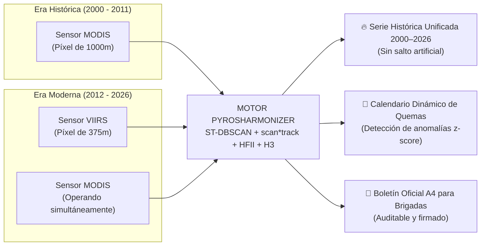

# 💡 Documento 01: La Idea
# PyrosHarmonizer — De la Fractura de Datos a la Inteligencia Territorial

---

## 📌 1. El Elevator Pitch (30 Segundos)

> *"Desde el año 2000, los satélites de la NASA vigilan los incendios del planeta. Pero en 2012, un salto tecnológico entre los sensores MODIS y VIIRS fracturó las series históricas de datos, provocando un aumento artificial de hasta un 400% en puntos de calor que engaña a los modelos climáticos y desorienta a los bomberos forestales.*  
>  
> ***PyrosHarmonizer** es la primera plataforma geoespacial abierta que elimina esta fractura instrumental mediante **clustering espacio-temporal ST-DBSCAN**, **reconstrucción física de la huella del píxel ($scan \times track$)** y **calibración radiométrica de energía (HFII)**. Convertimos 26 años de puntos satelitales desconectados en una sola serie continua de eventos reales de fuego y en un **Calendario Inteligente de Quemas**, empoderando a científicos y brigadistas para proteger los ecosistemas más vulnerables del planeta, comenzando por la Chiquitanía boliviana."*

---

## 🎯 2. ¿Qué es Exactamente PyrosHarmonizer?

**PyrosHarmonizer** no es un visor pasivo de mapas ni una simple agregación de puntos. Es un **motor científico de armonización y una plataforma de inteligencia territorial** que une dos eras de telemetría espacial de la NASA:

---

## 💎 3. La Propuesta de Valor Única (UVP)

| Enfoque Tradicional (Herramientas Actuales) | Enfoque PyrosHarmonizer |
| :--- | :--- |
| **Tratan el fuego como un punto matemático ($x, y$):** Ignoran que el satélite barre la Tierra con una cámara que deforma el píxel hasta $2.0 \times 4.8\text{ km}$ en los bordes. | **Reconstrucción Geométrica Real ($scan \times track$):** Proyecta la huella poligonal física de cada sensor según su ángulo cenital y paso orbital. |
| **Cuentan puntos satelitales crudos:** Si un incendio activa 7 píxeles de VIIRS, el sistema reporta "7 incendios", multiplicando falsamente las estadísticas. | **Clustering Físico ST-DBSCAN:** Agrupa los píxeles solapados en el espacio y en una ventana de 3.5 horas en **un único evento de fuego con perímetro poligonal**. |
| **Sumatoria ingenua de FRP (Potencia Radiativa):** Sumar la energía de VIIRS dispara artificialmente la potencia total respecto a MODIS. | **Índice Armonizado HFII:** Función de transferencia calibrada empíricamente que pondera el ciclo día/noche y la densidad energética real. |
| **Gráficos estáticos e informes planos:** Recibos genéricos difíciles de interpretar para brigadas y autoridades en campo. | **Boletín Oficial A4 de Alta Fidelidad + Split Screen:** Documento institucional listo para firma oficial con sellos criptográficos SHA-256 y mapas de alta resolución. |

---

## 👥 4. ¿A Quién Beneficia? (Casos de Impacto Directo)

### 🔬 A. Comunidad Científica y Modeladores Climáticos
- **El Reto:** Un climatólogo no puede entrenar modelos de emisiones de carbono ($CO_2$, metano) o de captura de biomasa si sus datos de entrada tienen una discontinuidad abrupta en enero de 2012 causada por un cambio de satélite.
- **La Solución PyrosHarmonizer:** Entrega una serie continua, homogénea y normalizada de 26 años (2000–2026), validada econométrica y estadísticamente mediante el **Test de Chow**, permitiendo calcular tendencias climáticas reales sin ruido instrumental.

### 🚒 B. Bomberos Forestales y Centros de Operaciones de Emergencia (COED / SERNAP)
- **El Reto:** Cuando un bombero ve en su pantalla 50 puntos de calor dispersos, no sabe si enfrenta 50 focos independientes o un solo mega-incendio con un frente activo de 15 kilómetros. Esto lleva a una mala asignación de camiones, brigadas y helicópteros cisterna.
- **La Solución PyrosHarmonizer:** Agrupa las detecciones en perímetros poligonales unificados, calcula el centro de masa dinámico del frente de fuego y emite alertas de severidad energética instantáneas.

### 🏛️ C. Autoridades de Regulación y Gobiernos Locales (ABT / Municipios)
- **El Reto:** Las prohibiciones de quema o "pausas ecológicas" suelen dictarse con fechas fijas de calendario que no coinciden con las verdaderas anomalías meteorológicas y de biomasa seca de cada año.
- **La Solución PyrosHarmonizer:** El **Calendario de Actividad de Quemas (*Burning Activity Calendar*)** calcula matrices de anomalía estacional ($z\text{-score}$), alertando con semanas de anticipación cuando una región entra en su ventana crítica de peligro extremo.

---

## 🏆 5. ¿Por Qué Esta Idea Cumple al 100% el Reto #8 de la NASA?

El Reto #8 de la NASA Space Apps Challenge exige:
1. *Armonizar las detecciones de puntos de calor de MODIS y VIIRS en el tiempo y el espacio.* 👉 **Resuelto mediante ST-DBSCAN y geometría $scan \times track$.**
2. *Explicar y corregir la discrepancia de resolución (1 km vs 375 m).* 👉 **Resuelto mediante la huella poligonal y grillas hexagonales Uber H3 (Res 7 y 8).**
3. *Construir un calendario o régimen de fuegos para evaluar patrones históricos.* 👉 **Resuelto con el Burning Activity Calendar y matrices de calor multianuales.**
4. *Demostrar la solución en un caso de estudio real.* 👉 **Resuelto con el caso emblemático de la Chiquitanía boliviana y la cuenca amazónica (2000–2026).**

