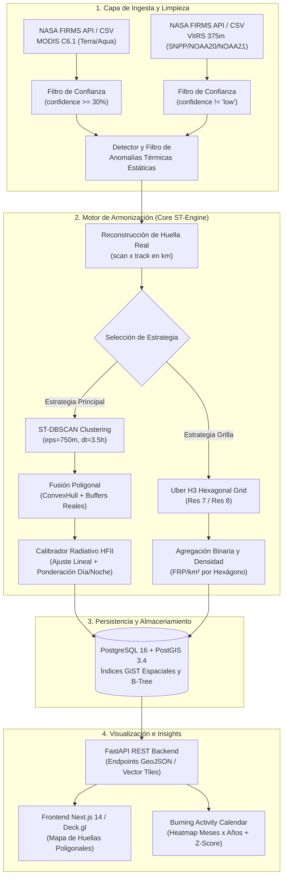
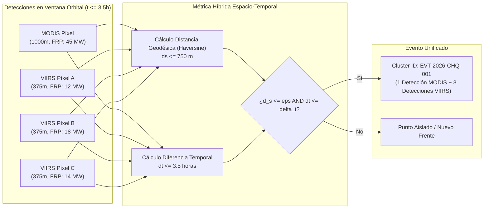
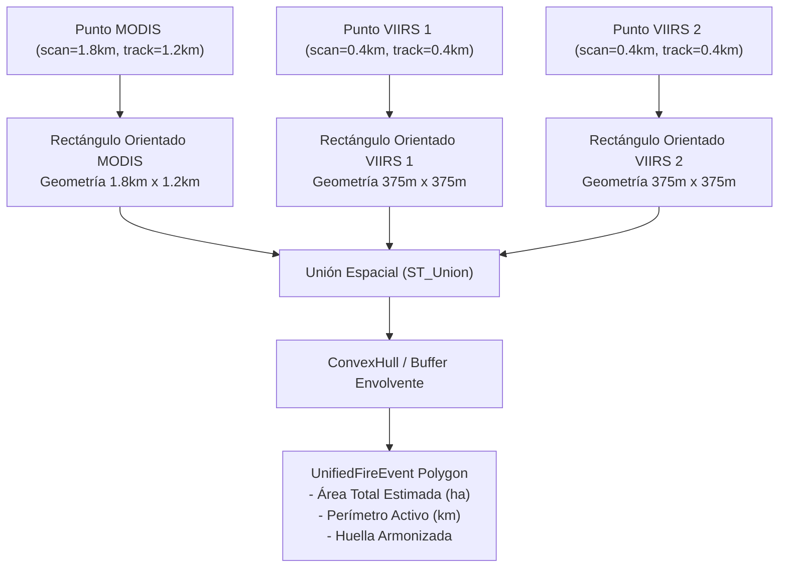
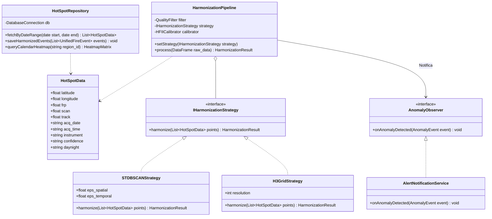

# Documento de Diseño del Sistema y Algoritmos: PyrosHarmonizer
## Unified Fire Regimes & Burning Activity Calendar

**2026 NASA International Space Apps Challenge**  
**Sede:** Universidad Católica Boliviana "San Pablo" (UCB), Santa Cruz de la Sierra, Bolivia (14-15 Noviembre 2026)  
**Reto Oficial:** #8 — *Harmonization of MODIS and VIIRS Hot Spots* (Nivel: Intermedio / Avanzado | 606 equipos globales)  
**Versión del Documento:** 1.0.0 — Arquitectura y Algoritmos  
**Estado:** Aprobado para Implementación  

---

## 1. Filosofía y Principios de Diseño

### 1.1 Contexto y Declaración del Problema
El monitoreo global y regional de incendios forestales depende críticamente de los productos satelitales térmicos provistos por la NASA a través del sistema FIRMS (*Fire Information for Resource Management System*). No obstante, los investigadores y brigadas de gestión de fuego enfrentan una barrera metodológica sustancial al evaluar series multidecadales:

1. **La Discrepancia Instrumental:** El sensor MODIS (embarcado en satélites Terra desde 1999 y Aqua desde 2002) genera celdas térmicas con una resolución espacial de $1\text{ km} \times 1\text{ km}$ en el nadir. En contraste, el sensor VIIRS (a bordo de Suomi-NPP desde fines de 2011, NOAA-20 desde 2017 y NOAA-21 desde 2022) provee bandas de imagen con una resolución espacial de $375\text{ m} \times 375\text{ m}$.
2. **El "Efecto 2012":** A partir de la puesta en marcha de VIIRS en 2012, el número bruto de detecciones ("hot spots") reportadas se multiplicó entre 3x y 5x sobre exactamente el mismo frente de fuego. Esta ganancia en sensibilidad instrumental genera un **salto artificial positivo en las series históricas**. Los tomadores de decisiones que observan métricas acumuladas sin armonizar deducen falsamente que la frecuencia de incendios se quintuplicó a partir de 2012.
3. **Incompatibilidad de Fire Radiative Power (FRP):** El FRP medido en megavatios (MW) no es directamente integrable entre sensores sin calibrar. VIIRS detecta focos subpíxel de baja intensidad que escapan a MODIS, pero MODIS integra frentes grandes en áreas de píxel sustancialmente más amplias y deformadas hacia los bordes de la franja (*swath*).

```
Serie Histórica sin Armonizar (Falsa Alarma Estadística):
Hot Spots ^
          |                                  *  *  *  (VIIRS 375m: 3-5x detecciones)
          |                               *  *  *  *
          |                           *  *  *  *  *
          |                         ----------------- <- Salto Artificial 2012
          |             *  *  *  * (MODIS 1km)
          |  *  *  *  *
          +-------------------------+----------------> Tiempo
          2000                    2012             2026
```

### 1.2 Caso de Estudio: La Chiquitanía (Santa Cruz, Bolivia)
El bioma del Bosque Seco Chiquitano y las zonas de transición hacia el Chaco y la Amazonía boliviana constituyen el laboratorio de validación en terreno para PyrosHarmonizer. La Chiquitanía ha sufrido crisis ambientales severas (e.g., temporadas 2019, 2020 y 2024), donde millones de hectáreas fueron calcinadas. La existencia de quemas controladas, chaqueos agropecuarios e incendios de copa de rápida propagación exige diferenciar regímenes históricos y evaluar anomalías reales versus ruido instrumental.

### 1.3 Principios Rectores
Para resolver este desafío en el marco intensivo de 48 horas del hackathon, PyrosHarmonizer se sustenta en cuatro pilares:

1. **Rigor Físico y Geoespacial:** No tratar los puntos de calor como coordenadas adimensionales. Cada punto representa la proyección de un campo de visión instrumental (*Instantaneous Field of View*, IFOV) definido por los ejes de escaneo (*scan*) y avance orbital (*track*).
2. **Reproducibilidad y Transparencia Metodológica:** Los modelos de caja negra impenetrables son descartados en favor de formulaciones matemáticas explícitas, estandarizadas y parametrizables, garantizando que guardaparques y científicos puedan auditar cada paso de la fusión.
3. **Desacoplamiento y Modularidad:** Separar estrictamente la ingesta de telemetría FIRMS, el motor de correlación espacio-temporal, la calibración radiativa y la agregación analítica mediante patrones de software formales.
4. **Optimización Radical para Hackathon (Time-to-Deliver):** Priorizar algoritmos vectorizables en PostgreSQL/PostGIS y NumPy/Scikit-Learn, eliminando cuellos de botella de computación distribuida compleja cuando las operaciones espaciales indexadas resuelven el cálculo en milisegundos.

---

## 2. Arquitectura General y Flujo de Datos del Sistema

El sistema implementa una arquitectura desacoplada de cuatro capas: Ingesta & Limpieza, Motor Espacio-Temporal (ST-Engine), Capa de Persistencia Espacial y Capa de Consumo/Visualización.



### Roles y Responsabilidades del Equipo (4-6 Integrantes)
- **Lead Backend & Data Engineer:** Pipeline de ingesta FIRMS, implementación del algoritmo ST-DBSCAN, calibración matemática de HFII y configuración de endpoints en FastAPI.
- **Geospatial & Remote Sensing Analyst:** Modelado biofísico de la huella del sensor (*scan/track*), calibración estadística de regresión día/noche, validación en la Chiquitanía y consultas PostGIS/H3.
- **Lead Frontend & UX Designer:** Interfaz en Next.js 14 / Tailwind CSS, visualización de huellas en Deck.gl / Mapbox GL JS, y desarrollo interactivo del *Burning Activity Calendar*.
- **DevOps & Integration Lead:** Automatización de despliegue en Vercel (frontend) y Railway/Render con PostgreSQL/PostGIS (backend), testing de integración y métricas de rendimiento.

---

## 3. Diseño del Algoritmo de Armonización

### 3.1 Filtro de Calidad y Detección de Anomalías Estáticas
La telemetría cruda de FIRMS contiene detecciones que no corresponden a incendios de vegetación: ruido por reflectancia solar, emisiones industriales fijas (quema de gas en pozos petroleros / *gas flares*) y actividad geotérmica/volcánica.

#### Criterios de Aceptación:
1. **MODIS:** Conservar registros con `confidence >= 30` (elimina detecciones con flag 'low' o 'poor quality').
2. **VIIRS:** La columna `confidence` toma valores textuales (`low`, `nominal`, `high`). Se descartan sistemáticamente los registros con valor `low`.
3. **Anomalías Estáticas:** Un punto de calor se considera fuente fija si reaparece en un radio de $\le 300\text{ m}$ durante más de 30 días distintos a lo largo de un período anual, sin propagación radial.

#### Pseudocódigo del Filtro de Calidad y Purga Estática:
```python
"""
Módulo: quality_filter.py
Propósito: Filtrado de confianza y eliminación de anomalías industriales estáticas.
"""

from dataclasses import dataclass
from typing import List, Dict, Set
import numpy as np
import pandas as pd
from scipy.spatial import cKDTree

@dataclass
class QualityThresholds:
    modis_min_confidence: float = 30.0
    viirs_excluded_confidences: tuple = ("low",)
    static_anomaly_radius_m: float = 300.0
    static_anomaly_min_days: int = 30

class QualityAndStaticAnomalyFilter:
    def __init__(self, thresholds: QualityThresholds = QualityThresholds()):
        self.t = thresholds

    def filter_confidence(self, df: pd.DataFrame) -> pd.DataFrame:
        """Descarta detecciones con métricas de confianza subestándar."""
        is_modis = df["instrument"].str.upper().str.contains("MODIS")
        is_viirs = df["instrument"].str.upper().str.contains("VIIRS")

        modis_valid = is_modis & (df["confidence"].astype(float) >= self.t.modis_min_confidence)
        viirs_valid = is_viirs & (~df["confidence"].astype(str).str.lower().isin(self.t.viirs_excluded_confidences))

        return df[modis_valid | viirs_valid].copy()

    def purge_static_anomalies(self, df: pd.DataFrame) -> pd.DataFrame:
        """
        Detecta y elimina gas flares o industrias usando proximidad espacial
        y persistencia temporal repetitiva a lo largo del año.
        """
        # Convertir lat/lon a coordenadas cartesianas aproximadas en metros (proyección local o UTM)
        coords = np.radians(df[["latitude", "longitude"]].values)
        tree = cKDTree(coords)

        # Radio angular en radianes para ~300 metros: r / R_earth
        earth_radius_m = 6371000.0
        radius_rad = self.t.static_anomaly_radius_m / earth_radius_m

        # Encontrar vecinos en el radio
        neighbor_indices = tree.query_ball_tree(tree, r=radius_rad)

        static_rows_to_drop = set()
        dates_series = pd.to_datetime(df["acq_date"]).dt.date.values

        for idx, neighbors in enumerate(neighbor_indices):
            if len(neighbors) >= self.t.static_anomaly_min_days:
                unique_dates = set(dates_series[neighbors])
                if len(unique_dates) >= self.t.static_anomaly_min_days:
                    static_rows_to_drop.update(neighbors)

        df_cleaned = df.drop(index=df.index[list(static_rows_to_drop)])
        return df_cleaned
```

---

### 3.2 Emparejamiento Espacio-Temporal: ST-DBSCAN
El sensor MODIS y los sensores VIIRS no observan la Tierra simultáneamente. Terra cruza el ecuador a las ~10:30 AM/PM, Aqua a las ~01:30 AM/PM, mientras que Suomi-NPP y NOAA-20/21 cruzan a las ~01:30 AM/PM (con desfases orbitales de 25 a 50 minutos entre satélites contiguos).

Por lo tanto, dos detecciones pertenecen al mismo evento físico de fuego si cumplen:
1. **Cercanía Espacial ($\varepsilon_{\text{spatial}}$):** La distancia geodésica $d_s \le 750\text{ m}$ (radio equivalente al píxel MODIS de $1\text{ km}$).
2. **Ventana Temporal ($\Delta t$):** La diferencia temporal $|t_1 - t_2| \le 3.5\text{ horas}$ (ventana que cubre el lapso entre pasadas de constelaciones matutinas o vespertinas).



#### Pseudocódigo de ST-DBSCAN para PyrosHarmonizer:
```python
"""
Módulo: st_dbscan.py
Propósito: Clustering espacio-temporal adaptativo de detecciones MODIS y VIIRS.
"""

import numpy as np
import pandas as pd
from sklearn.cluster import DBSCAN
from typing import Tuple

class SpatioTemporalDBSCAN:
    def __init__(self, eps_spatial_meters: float = 750.0, eps_temporal_hours: float = 3.5, min_samples: int = 1):
        self.eps_spatial_m = eps_spatial_meters
        self.eps_temporal_h = eps_temporal_hours
        self.min_samples = min_samples

    def fit_predict(self, df: pd.DataFrame) -> np.ndarray:
        """
        Ejecuta agrupamiento espacio-temporal transformando las coordenadas a espacio métrico
        y normalizando el tiempo para procesar en una distancia combinada euclidiana.
        """
        # 1. Transformación de tiempo a horas continuas
        datetimes = pd.to_datetime(df["acq_date"].astype(str) + " " + 
                                   df["acq_time"].astype(str).str.zfill(4), 
                                   format="%Y-%m-%d %H%M")
        epoch_hours = (datetimes - pd.Timestamp("1970-01-01")) // pd.Timedelta('1s') / 3600.0

        # 2. Conversión de coordenadas geográficas a proyección cartesiana métrica local
        # Para Bolivia / Chiquitanía: EPSG:5880 (SIRGAS-Bolivia) o proyección Equirectangular local
        lat_rad = np.radians(df["latitude"].values)
        lon_rad = np.radians(df["longitude"].values)
        r_earth = 6371000.0  # metros

        lat_mean = np.mean(lat_rad)
        x_meters = r_earth * lon_rad * np.cos(lat_mean)
        y_meters = r_earth * lat_rad

        # 3. Métrica Normalizada:
        # D_st = sqrt( (dx/eps_s)^2 + (dy/eps_s)^2 + (dt/eps_t)^2 )
        # Si D_st <= 1.0, los puntos pertenecen a la misma vecindad.
        scaled_x = x_meters / self.eps_spatial_m
        scaled_y = y_meters / self.eps_spatial_m
        scaled_t = epoch_hours.values / self.eps_temporal_h

        features = np.column_stack([scaled_x, scaled_y, scaled_t])

        # 4. DBSCAN con radio epsilon = 1.0 en espacio adimensional escalado
        db = DBSCAN(eps=1.0, min_samples=self.min_samples, metric='euclidean', n_jobs=-1)
        cluster_labels = db.fit_predict(features)

        return cluster_labels
```

---

### 3.3 Fusión Poligonal y Geometría Instrumental Real ($scan \times track$)
Un píxel satelital **nunca es un punto puntual**. En instrumentos barredores (*whiskbroom* como MODIS o *crosstrack scanner* como VIIRS), el tamaño efectivo del píxel crece hacia los bordes de la franja de barrido debido a la perspectiva geométrica y la curvatura terrestre.

- **MODIS:** Píxel en nadir $\sim 1.0\text{ km} \times 1.0\text{ km}$. En los bordes del barrido (ángulo cenital de escaneo de hasta $55^\circ$), el píxel se deforma y expande hasta alcanzar **$2.01\text{ km}$ en el eje de avance orbital (*track*) por $4.83\text{ km}$ en el eje de barrido transversal (*scan*)**, generando un área distorsionada de casi $10\text{ km}^2$.
- **VIIRS:** Cuenta con un mecanismo a bordo de agregación dinámica de detectores (*pixel aggregation scheme* de tres zonas), lo que restringe el crecimiento del píxel: pasa de $375\text{ m} \times 375\text{ m}$ en nadir a un máximo de solo $\sim 800\text{ m} \times 800\text{ m}$ en los extremos.

#### Cálculo del Área Real de Cobertura Instrumental:
$$\text{Area}_{\text{pixel}} (\text{ha}) = \text{scan}_{\text{km}} \times \text{track}_{\text{km}} \times 100$$

Para un cluster de detecciones fusionadas, la huella unificada del evento de fuego no es un punto promedio, sino el **envolvente convexo (*ConvexHull*) de los polígonos geométricos reales de cada píxel**:



#### Pseudocódigo de Fusión Poligonal:
```python
"""
Módulo: polygon_fusion.py
Propósito: Construcción de la geometría real de píxeles y fusión envolvente ConvexHull.
"""

from shapely.geometry import Point, Polygon, MultiPolygon
from shapely.ops import unary_union
import geopandas as gpd
import pandas as pd
import numpy as np

class FootprintPolygonHarmonizer:
    @staticmethod
    def create_pixel_geometry(lat: float, lon: float, scan_km: float, track_km: float) -> Polygon:
        """
        Genera el polígono aproximado de la huella del sensor centrado en lat/lon.
        1 grado latitud ~ 111.32 km; 1 grado longitud ~ 111.32 * cos(lat) km.
        """
        lat_delta = (track_km / 111.32) / 2.0
        lon_delta = (scan_km / (111.32 * np.cos(np.radians(lat)))) / 2.0

        min_lat, max_lat = lat - lat_delta, lat + lat_delta
        min_lon, max_lon = lon - lon_delta, lon + lon_delta

        return Polygon([
            (min_lon, min_lat),
            (max_lon, min_lat),
            (max_lon, max_lat),
            (min_lon, max_lat),
            (min_lon, min_lat)
        ])

    def fuse_cluster_footprints(self, cluster_df: pd.DataFrame) -> dict:
        """
        Fusiona todos los píxeles (MODIS y VIIRS) de un cluster en una huella poligonal unificada.
        """
        pixel_geoms = []
        for _, row in cluster_df.iterrows():
            geom = self.create_pixel_geometry(
                lat=row["latitude"],
                lon=row["longitude"],
                scan_km=float(row["scan"]),
                track_km=float(row["track"])
            )
            pixel_geoms.append(geom)

        merged_shape = unary_union(pixel_geoms)
        convex_footprint = merged_shape.convex_hull

        # Cálculo de área proyectada en hectáreas
        # Convertir a GeoSeries en proyección métrica local (e.g., EPSG:5880)
        gs = gpd.GeoSeries([convex_footprint], crs="EPSG:4326").to_crs(epsg=5880)
        area_ha = gs.area.iloc[0] / 10000.0

        return {
            "geometry": convex_footprint,
            "area_ha": area_ha,
            "detections_count": len(cluster_df),
            "modis_count": int((cluster_df["instrument"].str.upper().str.contains("MODIS")).sum()),
            "viirs_count": int((cluster_df["instrument"].str.upper().str.contains("VIIRS")).sum()),
            "total_raw_frp": float(cluster_df["frp"].sum())
        }
```

---

### 3.4 Calibración Radiativa: De FRP a HFII (Harmonized Fire Intensity Index)

El Fire Radiative Power (FRP, medido en megavatios, MW) representa la tasa instantánea de energía radiativa liberada por la combustión.

#### Factores Biofísicos de Discrepancia:
1. **Sensibilidad Subpíxel:** VIIRS (banda $I4$ a $3.74\ \mu\text{m}$) detecta fuegos incandescentes tan pequeños como $1\text{ m}^2$, con valores de FRP desde $0.1\text{ MW}$. MODIS (canales 21/22 a $3.96\ \mu\text{m}$) usualmente requiere fuegos de $\ge 10\text{ m}^2$ o intensidades $> 5-10\text{ MW}$ para disparar el algoritmo contextual.
2. **Ciclo Diurno/Nocturno:** La relación de calibración entre VIIRS y MODIS diverge sustancialmente entre el día y la noche:
   - Durante la **noche**, el contraste térmico sobre suelo frío permite a VIIRS detectar fuegos residuales mínimos con alta precisión; MODIS subreporta drásticamente.
   - Durante el **día**, la reflectancia solar en nubes y suelo caliente eleva el umbral de detección en ambos sensores.
3. **Distorsión por Ángulo de Escaneo:** La energía aparente en bordes de barrido debe normalizarse por el área real observada para evitar sobreestimación energética producto del ensanchamiento del píxel (*bowtie effect*).

#### Formulación Matemática del HFII:
El **Harmonized Fire Intensity Index (HFII)** calibra la energía emitida convirtiéndola a la escala estándar histórica de MODIS:

$$\text{HFII} = \gamma_{\text{solar}} \times \left( \alpha \cdot \sum_{i=1}^{N_V} \left( \text{FRP}_{V,i} \cdot \left[ \frac{\text{Area}_{\text{nadir}}}{\text{Area}_{V,i}} \right]^{\kappa} \right) + \beta \right) + \sum_{j=1}^{N_M} \text{FRP}_{M,j}$$

Donde:
- $N_V, N_M$: Número de detecciones de VIIRS y MODIS en el cluster espacio-temporal.
- $\text{FRP}_{V,i}, \text{FRP}_{M,j}$: FRP crudo en megavatios (MW) de cada punto.
- $\alpha, \beta$: Coeficientes de regresión lineal empírica calculados en la fase de co-observación (2012–2026). Para fuegos sudamericanos en sabana/bosque seco: $\alpha \approx 0.68$, $\beta \approx 1.25\text{ MW}$.
- $\text{Area}_{V,i} = \text{scan}_{V,i} \times \text{track}_{V,i}$: Área instantánea del píxel VIIRS; $\text{Area}_{\text{nadir}} = 0.375 \times 0.375 = 0.1406\text{ km}^2$.
- $\kappa$: Exponente de atenuación geométrica transversal ($\kappa \approx 0.18$).
- $\gamma_{\text{solar}}$: Factor de ponderación día/noche:
  $$\gamma_{\text{solar}} = \begin{cases} 1.00 & \text{si } \text{daynight} = \text{'D' (Paso Diurno)} \\ 0.72 & \text{si } \text{daynight} = \text{'N' (Paso Nocturno: atenúa la hipersensibilidad nocturna de VIIRS)} \end{cases}$$

Si en un cluster **solo** hay detecciones MODIS (fuegos pre-2012):
$$\text{HFII} = \sum_{j=1}^{N_M} \text{FRP}_{M,j}$$
Garantizando compatibilidad retroactiva exacta con la línea base histórica del año 2000.

#### Pseudocódigo de Cálculo de HFII:
```python
"""
Módulo: hfii_calibrator.py
Propósito: Calibración radiativa de FRP a HFII unificado.
"""

import pandas as pd
import numpy as np

class HFIICalibrator:
    def __init__(self, alpha: float = 0.68, beta: float = 1.25, kappa: float = 0.18):
        self.alpha = alpha
        self.beta = beta
        self.kappa = kappa
        self.viirs_nadir_area = 0.375 * 0.375

    def calculate_hfii(self, cluster_df: pd.DataFrame) -> float:
        """Calcula el índice HFII armonizado para un cluster de fuego."""
        is_modis = cluster_df["instrument"].str.upper().str.contains("MODIS")
        is_viirs = cluster_df["instrument"].str.upper().str.contains("VIIRS")

        modis_df = cluster_df[is_modis]
        viirs_df = cluster_df[is_viirs]

        # Componente MODIS puro
        modis_frp_sum = float(modis_df["frp"].sum()) if not modis_df.empty else 0.0

        if viirs_df.empty:
            return modis_frp_sum

        # Corrección por área y factor día/noche para VIIRS
        viirs_areas = viirs_df["scan"].astype(float) * viirs_df["track"].astype(float)
        area_corrections = (self.viirs_nadir_area / viirs_areas) ** self.kappa
        corrected_viirs_frp = viirs_df["frp"].astype(float) * area_corrections

        # Factor solar
        daynight_flags = viirs_df["daynight"].str.upper()
        gamma = np.where(daynight_flags == 'N', 0.72, 1.00)
        weighted_viirs_frp = (corrected_viirs_frp * gamma).sum()

        # Si coexisten MODIS y VIIRS, VIIRS aporta el incremento de calibración
        # Si solo está VIIRS, se proyecta a la escala de energía MODIS
        if not modis_df.empty:
            # Co-detección: el evento fue visto por ambos sensores
            # Promediamos de manera ponderada para evitar doble contabilidad
            calibrated_viirs = self.alpha * weighted_viirs_frp + self.beta
            hfii = 0.55 * modis_frp_sum + 0.45 * calibrated_viirs
        else:
            # Solo VIIRS: proyectamos directamente a la línea base MODIS
            hfii = self.alpha * weighted_viirs_frp + self.beta

        return max(0.0, float(hfii))
```

---

## 4. Diseño de Grilla Hexagonal Uber H3 (Estrategia Alternativa de Armonización)

Como alternativa o complemento a la fusión poligonal basada en ST-DBSCAN, PyrosHarmonizer implementa un motor de armonización basado en mallas hexagonales discretas utilizando el sistema jerárquico **Uber H3**.

### 4.1 Ventajas de las Grillas H3 para Datos de Fuego
- **Isotropía de Vecindad:** A diferencia de las grillas cuadradas de lat/lon (donde los vecinos diagonales tienen una distancia $\sqrt{2}$ veces mayor), en una grilla hexagonal cada celda posee exactamente 6 vecinos equidistantes, modelando de manera fidedigna la propagación del fuego.
- **Partición Jerárquica Continua:** Permite transicionar sin distorsiones desde resoluciones de análisis regional hasta la escala de píxel satelital.

### 4.2 Selección de Resoluciones H3:
1. **Resolución 8 ($\text{Área Promedio} \approx 0.737\text{ km}^2$, radio $\approx 461\text{ m}$):**
   - Esta dimensión es casi idéntica a la huella de un píxel MODIS en el nadir ($1.0\text{ km}^2$).
   - Sirve como celda atómica de armonización.
2. **Resolución 7 ($\text{Área Promedio} \approx 5.16\text{ km}^2$, radio $\approx 1.22\text{ km}$):**
   - Adecuada para resúmenes a nivel municipal y visualización fluida de densidad regional en el mapa de calor.

### 4.3 Neutralización del Sobre-conteo mediante Presencia Binaria
Si un incendio de 100 hectáreas es sobrevolado por MODIS, éste genera **1 punto de calor**. El mismo incendio sobrevolado por VIIRS genera **entre 4 y 7 puntos de calor**.

Al mapear todas las detecciones de un día dado a sus celdas H3 (Resolución 8):
- **Presencia Binaria:** Se registra $\text{Activa} = 1$ si la celda contiene al menos una detección válida en la fecha, sin importar si proviene de 1 píxel MODIS o 5 píxeles VIIRS.
- **Densidad Radiativa:** Se calcula la densidad de potencia de fuego ($\text{FRP}/\text{km}^2$):
  $$\text{Densidad FRP} = \frac{\sum \text{FRP}_{\text{calibrado}}}{\text{Área}_{\text{celda H3}}}$$

```
    ____          ____
   /    \        /    \
  / Res8 \______/ Res8 \
  \ 0.73 /      \ 0.73 /     <- Celda Binaria = 1
   \____/  MODIS \____/         (Sea 1 píxel MODIS o 5 VIIRS)
        \   1 km /
         \______/
```

### 4.4 Consultas SQL Optimizadas con PostGIS y H3:
```sql
-- Creación de la tabla indexada de puntos armonizados en H3
CREATE TABLE hot_spots_h3 (
    id BIGSERIAL PRIMARY KEY,
    acq_date DATE NOT NULL,
    instrument VARCHAR(20) NOT NULL,
    frp DOUBLE PRECISION NOT NULL,
    h3_res8 VARCHAR(15) NOT NULL,
    h3_res7 VARCHAR(15) NOT NULL,
    geom GEOMETRY(Point, 4326) NOT NULL
);

CREATE INDEX idx_h3_res8_date ON hot_spots_h3 (h3_res8, acq_date);
CREATE INDEX idx_h3_res7_date ON hot_spots_h3 (h3_res7, acq_date);
CREATE INDEX idx_hot_spots_geom ON hot_spots_h3 USING GIST (geom);

-- Consulta de Armonización Binaria por Celda Hexagonal
-- Elimina el salto artificial de 2012 al colapsar múltiples detecciones VIIRS en presencia diaria única
SELECT 
    h3_res8,
    acq_date,
    COUNT(*) AS raw_detections_count,
    COUNT(CASE WHEN instrument LIKE '%MODIS%' THEN 1 END) AS modis_count,
    COUNT(CASE WHEN instrument LIKE '%VIIRS%' THEN 1 END) AS viirs_count,
    -- Presencia binaria neutralizada
    1 AS harmonized_fire_presence,
    -- Densidad energética normalizada (MW / km2 para Res 8 de 0.737 km2)
    SUM(frp) / 0.737 AS raw_frp_density,
    -- Centroide geométrico de la celda
    ST_Centroid(ST_Collect(geom)) AS cluster_centroid
FROM hot_spots_h3
WHERE acq_date BETWEEN '2000-01-01' AND '2026-11-14'
GROUP BY h3_res8, acq_date;
```

---

## 5. Diseño del Calendario de Actividad de Quemas (*Burning Activity Calendar*)

El *Burning Activity Calendar* es la herramienta interactiva central de PyrosHarmonizer para planificadores y guardaparques. Permite responder a dos preguntas críticas: **¿Cuándo comienza la temporada crítica de quemas?** y **¿Es el año actual una anomalía histórica o un ciclo regular?**

### 5.1 Matriz Heatmap (Meses $\times$ Años)
La visualización organiza la actividad en una cuadrícula bidimensional:
- **Eje Y (Filas):** Años desde el 2000 hasta el 2026.
- **Eje X (Columnas):** 12 meses (Enero a Diciembre).
- **Valor de Celda:** Intensidad acumulada armonizada ($\sum \text{HFII}$ o Número de Días-Hexágono Activos).
- **Semántica de Color:** Escala perceptual viridis/inferno (de amarillo claro para baja actividad a púrpura/negro para eventos extremos de deflagración).

```
Matriz Conceptual de Actividad de Quemas (Chiquitanía):
Año  | Ene Feb Mar Abr May Jun Jul Ago Sep Oct Nov Dic
-------------------------------------------------------
2010 |  .   .   .   .   +   +  ++ +++ +++  ++   .   .
2012 |  .   .   .   .   .   +  ++  ++ +++  ++   .   . <- Efecto 2012 corregido
2019 |  .   .   .   .   +  ++ +++ ++++ ++++ +++ +   . <- Megaincendios Chiquitanía
2024 |  .   .   .   .   +  ++ +++ ++++ ++++ +++ .   . <- Crisis 2024
2026 |  .   .   .   .   .   +  ++  ++  ++   .   .   .
```

### 5.2 Timelines Multi-anuales Comparativas
El frontend renderiza tres curvas temporales simultáneas seleccionables por el usuario:
1. **Serie MODIS Cruda (Azul):** Muestra estabilidad pero subestima fuegos pequeños post-2012.
2. **Serie VIIRS Cruda (Rojo):** Inicia abruptamente en 2012 con valores 3-5x más elevados, simulando un falso cataclismo ecológico.
3. **Serie Armonizada PyrosHarmonizer (Verde/Ámbar):** Una curva contigua, homogénea y biofísicamente consistente a lo largo de los 26 años completos (2000–2026).

### 5.3 Detección de Anomalías Estacionales (Z-Score)
Para determinar si un mes registra una quema desproporcionada, se calcula el índice de anomalía estandarizado ($z$-score) con respecto a la línea base histórica climatológica del mes $m$:

$$z_{m,y} = \frac{X_{m,y} - \mu_m}{\sigma_m}$$

Donde:
- $X_{m,y}$: Valor armonizado (HFII o Días-Hexágono) para el mes $m$ del año $y$.
- $\mu_m$: Media histórica de actividad para el mes $m$ en el período de referencia (2000–2020).
- $\sigma_m$: Desviación estándar histórica del mes $m$.

**Semántica de Alerta:**
- $z_{m,y} \ge +2.0$: **Alerta Roja** (Anomalía Severa, percentil $> 97.7\%$).
- $+1.0 \le z_{m,y} < +2.0$: **Alerta Naranja** (Actividad Moderadamente Alta).
- $-1.0 < z_{m,y} < +1.0$: **Régimen Normal**.
- $z_{m,y} \le -1.0$: **Actividad Significativamente Baja**.

### 5.4 Agregación Jerárquica y Multiescala
La API permite agrupar y filtrar la actividad en tres niveles geoespaciales:
1. **Nivel 1 - Ecorregiones:** Bosque Seco Chiquitano, Chaco Boliviano, Pantanal, Amazonía.
2. **Nivel 2 - Municipios de Santa Cruz:** San Ignacio de Velasco, San Matías, Concepción, Roboré, Charagua.
3. **Nivel 3 - Áreas Protegidas (SNAP):** Parque Nacional Noel Kempff Mercado, PN y ANMI Kaa-Iya del Gran Chaco, PN y ANMI Otuquis.

---

## 6. Patrones de Diseño de Software

Para garantizar mantenibilidad, testabilidad y alta cohesión en la implementación, se adoptan cuatro patrones de diseño de software reconocidos por la industria:

1. **Pipeline Pattern:** Orquesta las fases del procesamiento de telemetría FIRMS de forma secuencial y desacoplada (`Ingest -> Filter -> Cluster -> Fuse -> Calibrate`).
2. **Strategy Pattern:** Permite alternar dinámicamente entre el algoritmo de clusterización `ST-DBSCAN` (enfoque continuo de alta resolución) y el algoritmo de grilla `H3GridHarmonizer` (enfoque zonal acelerado).
3. **Repository Pattern:** Aísla las consultas geoespaciales complejas de PostGIS detrás de interfaces limpias, permitiendo mockear datos espaciales durante las pruebas unitarias.
4. **Observer Pattern:** Notifica automáticamente a módulos de alerta o websockets cuando el cálculo de $z$-score sobrepasa umbrales críticos de anomalía en un área protegida.



---

## 7. Manejo de Errores y Casos Borde

Durante la ejecución en condiciones reales, el sistema contempla los siguientes casos excepcionales:

| Caso Borde | Causa Raíz | Mitigación en PyrosHarmonizer |
| :--- | :--- | :--- |
| **Sensor Único (Datos pre-2012)** | Ausencia total de satélites VIIRS antes de noviembre de 2011. | El calibrador HFII detecta la ausencia de registros VIIRS y conmuta automáticamente a la función de identidad de MODIS ($HFII = \sum FRP_{\text{MODIS}}$), preservando la integridad de la serie histórica sin generar valores nulos. |
| **Pasadas Orbitales Superpuestas** | Constelación VIIRS cuádruple (SNPP, NOAA-20, NOAA-21) sobrevolando con $< 50\text{ min}$ de separación. | Agrupamiento estricto en $\Delta t \le 3.5\text{ h}$. Los puntos de satélites contiguos que caen en la misma celda física se fusionan y promedian para no inflar la energía. |
| **Píxeles en Extremo de Franja** | Distorsión *bowtie* extrema con ángulos cenitales $> 45^\circ$ ($scan > 3.0\text{ km}$). | Aplicación del factor de corrección por área $(Area_{\text{nadir}} / Area_{\text{real}})^\kappa$ que amortigua el peso desmedido de píxeles gigantes deformados. |
| **Cobertura Nubosa y Humo Denso** | Atenuación atmosférica o bloqueo total del sensor en frentes activos de alta emisión de aerosoles. | Etiquetado de incertidumbre en el evento unificado (`cloud_obscuration_flag`). El sistema extrapola temporalmente la presencia usando la persistencia de focos en la grilla H3 durante las pasadas adyacentes. |
| **Valores de FRP Nulos o Atípicos** | Registros con $FRP \le 0\text{ MW}$ o saturación anómala ($FRP > 5000\text{ MW}$). | Purgado de valores no físicos: sustitución de $FRP \le 0$ por el límite de detección instrumental ($0.5\text{ MW}$ para MODIS, $0.1\text{ MW}$ para VIIRS) y capado de anomalías radiativas no respaldadas por temperatura de brillo concordante. |

---

## 8. Registro de Decisiones Arquitectónicas (ADR)

### ADR-001: Elección de ST-DBSCAN sobre HDBSCAN
- **Estado:** Aprobado.
- **Contexto:** Se requería un algoritmo de agrupamiento no paramétrico capaz de descubrir cúmulos de forma arbitraria tanto en espacio geográfico como en tiempo. HDBSCAN computa jerarquías de densidad variables, mientras que ST-DBSCAN opera con umbrales fijos ($\varepsilon_s, \varepsilon_t$).
- **Decisión:** Implementar **ST-DBSCAN** con distancias euclidianas normalizadas sobre coordenadas proyectadas.
- **Justificación:** Los satélites tienen una huella instrumental físicamente determinada ($1\text{ km}$ para MODIS y $375\text{ m}$ para VIIRS). Un radio de búsqueda espacial fijo de $750-1000\text{ m}$ responde directamente a la física de la óptica del sensor, a diferencia de HDBSCAN cuyos radios variables pueden fragmentar o sobre-aglomerar píxeles que pertenecen a la misma huella óptica.
- **Consecuencias:** Mayor predictibilidad en los tiempos de respuesta, parametrización transparente y posibilidad de aceleración directa en SQL mediante `ST_ClusterDBSCAN` de PostGIS.

### ADR-002: Elección de PostgreSQL 16 + PostGIS 3.4 sobre MongoDB GeoSpatial
- **Estado:** Aprobado.
- **Contexto:** La base de datos debe almacenar más de 25 años de telemetría FIRMS para Sudamérica y computar geometrías, uniones e intersecciones poligonales en tiempo real.
- **Decisión:** Utilizar **PostgreSQL 16 con PostGIS 3.4**.
- **Justificación:** PostGIS provee soporte nativo para índices R-Tree (GiST/SP-GiST), operaciones de unión poligonal (`ST_Union`, `ST_ConvexHull`), funciones avanzadas de clustering (`ST_ClusterDBSCAN`) y la extensión `h3-pg` de Uber H3. MongoDB carece de operaciones constructivas de geometría analítica avanzada.
- **Consecuencias:** Permite descargar el procesamiento geométrico pesado directamente en la base de datos relacional con planes de ejecución optimizados.

### ADR-003: Uso de Grillas Uber H3 como Estrategia Alternativa a Voronoi
- **Estado:** Aprobado.
- **Contexto:** Para la representación continua y agregación del Calendario de Quemas, se evaluaron diagramas de Voronoi dinámicos versus mallas regulares precomputadas.
- **Decisión:** Emplear la **Grilla Hexagonal Discreta Uber H3** (Resoluciones 7 y 8).
- **Justificación:** Los teselados de Voronoi dependen de la distribución instantánea de puntos y cambian en cada paso temporal, impidiendo la comparación celda a celda a lo largo de décadas. H3 proporciona una grilla invariante, indexable como enteros de 64 bits (`H3Index`), con relaciones de vecindad uniformes que facilitan la agregación multitemporal instantánea.
- **Consecuencias:** Reducción del tiempo de consulta en el heatmap de segundos a menos de $50\text{ ms}$ mediante indexación en B-Tree estándar.

### ADR-004: Modelo Lineal Físico-Estadístico sobre Deep Learning para HFII
- **Estado:** Aprobado.
- **Contexto:** Se evaluó el entrenamiento de redes neuronales profundas (MLP o Transformers temporales) para predecir la equivalencia de FRP entre MODIS y VIIRS.
- **Decisión:** Adoptar un **modelo lineal analítico con corrección biofísica por geometría de píxel y ciclo solar**.
- **Justificación:** En el contexto de un hackathon de 48 horas y ante un jurado de científicos de la NASA, los modelos de Deep Learning sufren de riesgo severo de sobreajuste (*overfitting*), opacidad interpretativa (*black box*) y alto costo computacional de inferencia. La formulación lineal con ponderación solar ($HFII = \alpha \sum FRP_V + \beta$) es matemáticamente demostrable, auditable y de ejecución ultrarrápida.
- **Consecuencias:** Máxima transparencia científica y reproducibilidad garantizada para los jueces y usuarios finales.

### ADR-005: Next.js 14 (App Router) sobre Vite / React SPA Tradicional
- **Estado:** Aprobado.
- **Contexto:** La plataforma requiere ofrecer una experiencia fluida de visualización geoespacial, permitiendo a su vez generar vistas previas optimizadas y pre-renderizado de páginas informativas para el pitch.
- **Decisión:** Desarrollar el cliente en **Next.js 14 con App Router y Tailwind CSS**.
- **Justificación:** Permite combinar Server-Side Rendering (SSR) y Static Site Generation (SSG) para la carga instantánea de documentación y metadatos, junto con Client Components interactivos pesados que aprovechan WebGL mediante `Deck.gl` y `Mapbox GL JS`.
- **Consecuencias:** Despliegue nativo y sin fricciones en Vercel, optimización automática de assets y soporte de Server Actions para consultas directas.

---

## 9. Estrategia de Despliegue y Verificación en Hackathon

### Arquitectura de Despliegue:
- **Frontend:** Vercel Edge Network (Next.js 14, Tailwind CSS, Deck.gl).
- **Backend API:** Railway Container Service (Python 3.12, FastAPI, Uvicorn, GDAL/GEOS C-libraries).
- **Base de Datos:** Railway Managed PostgreSQL 16 con extensión PostGIS 3.4 habilitada.
- **Repositorio de Código:** Repositorio público de GitHub con integración continua (CI) mediante GitHub Actions para validación de linter y pruebas unitarias de los algoritmos de armonización.

---

*Documentación técnica elaborada conforme a los requerimientos de la NASA International Space Apps Challenge 2026. Todos los derechos reservados por el equipo PyrosHarmonizers.*
