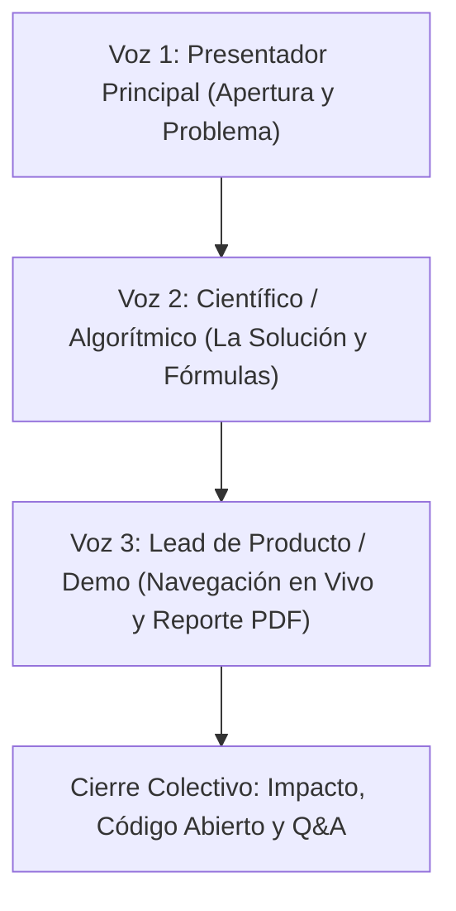

# 🛰️ PyrosHarmonizer: Carpeta Maestra de Exposición y Pitch
### NASA International Space Apps Challenge 2026 — Reto #8: Harmonization of MODIS and VIIRS Hot Spots
**Sede:** Santa Cruz de la Sierra, Bolivia — Universidad Católica Boliviana "San Pablo" (UCB)  
**Equipo:** PyrosHarmonizers  

---

## 📂 Contenido del Kit de Exposición

Esta carpeta contiene todo el material estratégico, técnico, narrativo y científico estructurado para ganar la evaluación del jurado de la NASA:

| Archivo | Propósito | Tiempo de Lectura |
| :--- | :--- | :--- |
| [**01_LA_IDEA.md**](file:///d:/ProyectoHackattonNasa/PyrosHarmonizers1/docs/01_LA_IDEA.md) | **Concepto, visión, propuesta de valor única y qué es PyrosHarmonizer.** | 3 min |
| [**02_EL_PROBLEMA.md**](file:///d:/ProyectoHackattonNasa/PyrosHarmonizers1/docs/02_EL_PROBLEMA.md) | **El "Efecto 2012", la fractura instrumental, sesgos geométricos y su costo ecológico real.** | 4 min |
| [**03_COMO_LO_RESUELVE.md**](file:///d:/ProyectoHackattonNasa/PyrosHarmonizers1/docs/03_COMO_LO_RESUELVE.md) | **La solución algorítmica y técnica: ST-DBSCAN, calibración FRP/HFII, grillas H3 y plataforma.** | 5 min |
| [**04_GUION_PITCH_3_MINUTOS.md**](file:///d:/ProyectoHackattonNasa/PyrosHarmonizers1/docs/04_GUION_PITCH_3_MINUTOS.md) | **Guion palabra por palabra para la presentación cronometrada de 3 minutos ante el jurado.** | 3 min |
| [**05_PREGUNTAS_Y_RESPUESTAS_JURADO.md**](file:///d:/ProyectoHackattonNasa/PyrosHarmonizers1/docs/05_PREGUNTAS_Y_RESPUESTAS_JURADO.md) | **Banco de 15 preguntas difíciles técnicas y científicas del jurado con respuestas blindadas.** | 6 min |
| [**06_EVIDENCIA_CIENTIFICA_Y_METRICAS.md**](file:///d:/ProyectoHackattonNasa/PyrosHarmonizers1/docs/06_EVIDENCIA_CIENTIFICA_Y_METRICAS.md) | **Fórmulas matemáticas, tablas de métricas, Test de Chow y resultados en la Chiquitanía.** | 4 min |

---

## 🎯 Estructura de Roles Sugerida para la Exposición

1. **Orador 1 (El Gancho y el Problema - 0:00 a 0:45):**
   - Presenta el conflicto: 26 años de satélites NASA pero con una fractura en 2012 que engaña a científicos y brigadistas.
2. **Orador 2 (La Solución Científica - 0:45 a 1:45):**
   - Explica el ST-DBSCAN, la huella $scan \times track$, y la calibración del FRP al índice unificado HFII.
3. **Orador 3 (La Demo y el Impacto - 1:45 a 2:45):**
   - Muestra la plataforma en vivo: el visor comparativo *Split-Screen*, el Calendario de Quemas y la generación instantánea del Boletín Oficial A4 en PDF.
4. **Cierre (Llamado a la Acción - 2:45 a 3:00):**
   - Destaca la escalabilidad global con impacto inmediato en la Chiquitanía boliviana y la Amazonía.

---

## 📋 Checklist Rápido 10 Minutos Antes de Subir al Escenario

- [ ] **Frontend en Vivo:** Verificar que la URL de Vercel cargue correctamente en el navegador (`https://pyrosharmonizers1.vercel.app` o URL asignada).
- [ ] **Modo de Contingencia:** Recordar que si el túnel Cloudflare o el internet de la sala fallan, el frontend tiene precargado el dataset de la Chiquitanía (`NFR-006 Offline Fallback`).
- [ ] **Pestañas Listas:**
  1. Portal de Acceso (Modo Jurado 1-Clic).
  2. Vista Comparativa *Split-Screen* (MODIS vs VIIRS vs Armonizado).
  3. Calendario de Quemas (*Burning Activity Calendar*).
  4. Botón de **"Boletín Oficial (PDF)"** para abrir la vista de impresión en alta resolución A4.
- [ ] **Diapositivas de Respaldo:** Tener a mano las gráficas del salto de 2012 y el Test de Chow de [06_EVIDENCIA_CIENTIFICA_Y_METRICAS.md](file:///d:/ProyectoHackattonNasa/PyrosHarmonizers1/docs/06_EVIDENCIA_CIENTIFICA_Y_METRICAS.md).

