# 🚀 Plan de Implementación Detallado — PyrosHarmonizer
## 2026 NASA International Space Apps Challenge
**Sede:** UCB Santa Cruz de la Sierra, Bolivia | **Fecha:** 14-15 Noviembre 2026  
**Reto:** #8 — Harmonization of MODIS and VIIRS Hot Spots (Nivel Intermedio / Avanzado — 606 equipos globales)  
**Proyecto:** PyrosHarmonizer — Unified Fire Regimes & Burning Activity Calendar  
**Duración del Sprint:** 48 Horas | **Equipo:** 4 a 6 integrantes  

---

## 📋 Resumen Ejecutivo y Alcance del Desafío

Desde el año 2000, el sensor **MODIS** (satélites Terra y Aqua) ha documentado incendios forestales globales a una resolución de 1 km. A partir de 2012, el sensor **VIIRS** (Suomi-NPP, NOAA-20 y NOAA-21) introdujo bandas de 375 m, capturando entre 3 y 5 veces más focos de calor y detectando quemas más pequeñas y frías. Esta transición tecnológica provocó el denominado **"Efecto 2012"**: un salto artificial y abrupto en las estadísticas multianuales de focos de calor que distorsiona la toma de decisiones ambientales. Asimismo, las métricas de Potencia Radiativa del Fuego (**FRP**, *Fire Radiative Power*) entre ambos instrumentos difieren notablemente debido a la saturación de píxeles, la resolución angular y la calibración radiométrica.

**PyrosHarmonizer** resuelve esta discontinuidad mediante un motor analítico geoespacial avanzado que combina:
1. Reconstrucción de la geometría real de píxel ($scan \times track$).
2. Agrupamiento espacio-temporal adaptativo con **ST-DBSCAN** y fusión poligonal (*ConvexHull*).
3. Calibración empírica y radiométrica de energía hacia el **Índice Armonizado de Intensidad de Fuego (HFII)**.
4. Mapeo multiescalar en grillas hexagonales **Uber H3** y generación de un **Calendario de Actividad de Quemas** continuo (2000–2026).
5. Demostración práctica y validación en el bioma de **La Chiquitanía** (Santa Cruz, Bolivia).

---

## 👥 1. Roles del Equipo y Matriz de Responsabilidades

El equipo de 4 a 6 personas opera bajo un modelo ágil de alta sincronización optimizado para sprints de 48 horas.

### 1.1 Perfiles y Especialidades

| Rol | Icono | Responsabilidades Clave | Stack Tecnológico Principal |
| :--- | :---: | :--- | :--- |
| **Lead Backend / Data Engineer** | 🔧 | • Pipeline de ingesta ETL (NASA FIRMS CSV/API)<br>• Diseño e indexación de esquemas PostGIS<br>• Endpoints RESTful con FastAPI<br>• Caching con Redis/in-memory y serialización GeoJSON | Python 3.12, FastAPI, PostgreSQL 16, PostGIS 3.4, SQLAlchemy 2.0, GeoPandas, Pydantic v2 |
| **Lead Frontend / UX** | 🎨 | • Arquitectura web interactiva en Next.js 14<br>• Visualización cartográfica (Mapbox GL JS + Deck.gl)<br>• Componente visual "Calendario de Quemas" (Heatmap)<br>• Diseño UI/UX responsivo y accesible | React 18, Next.js 14 (App Router), TypeScript, Tailwind CSS, Mapbox GL JS, Deck.gl, Recharts, Lucide Icons |
| **Geospatial Analyst / Algorithm Dev** | 🌍 | • Implementación y ajuste de ST-DBSCAN espacio-temporal<br>• Fusión poligonal y reconstrucción geométrica ($scan \times track$)<br>• Calibración estadística FRP $\rightarrow$ HFII<br>• Agregación y teselación hexagonal Uber H3 | Python 3.12, Shapely, Scikit-Learn, PySAL, H3-py, Rasterio, NumPy/SciPy |
| **DevOps / Integration Lead** | ⚙️ | • Orquestación local con Docker Compose<br>• Pipelines CI/CD en GitHub Actions<br>• Despliegue en producción (Railway + Vercel)<br>• Contratos de interfaz API $\leftrightarrow$ Frontend, monitoreo y logs | Docker, Docker Compose, Railway, Vercel, GitHub Actions, Nginx, Uvicorn, Bash/PowerShell |
| *(Opcional)* **Data Scientist / ML** | 📊 | • Regresión no lineal y corrección de sesgo FRP inter-sensores<br>• Modelado de series temporales de regímenes de fuego<br>• Validación cruzada en el caso Chiquitanía (2010–2026)<br>• Generación de gráficos analíticos para pitch | JupyterLab, Statsmodels, Scikit-learn, Seaborn, Matplotlib, DuckDB |
| *(Opcional)* **Designer / Pitch Lead** | 🎬 | • Storytelling del pitch de 7 diapositivas y guion técnico<br>• Producción, captura y edición del video de 30 segundos<br>• Paleta de colores cartográfica (simbología NASA/FIRMS)<br>• Entrega formal en la plataforma de Space Apps | Figma, Premiere / CapCut, Canva, OBS Studio, Audacity |

### 1.2 Matriz RACI (Responsible, Accountable, Consulted, Informed)

| Área / Entregable | Backend Lead | Frontend Lead | Geospatial Dev | DevOps Lead | Data Scientist | Pitch Lead |
| :--- | :---: | :---: | :---: | :---: | :---: | :---: |
| **Arquitectura de Base de Datos PostGIS** | **A / R** | C | C | I | C | I |
| **Ingesta de Datos NASA FIRMS** | **A / R** | I | C | C | C | I |
| **Motor ST-DBSCAN & Fusión Poligonal** | C | I | **A / R** | I | C | I |
| **Calibración FRP $\rightarrow$ HFII & H3** | C | I | **A** | I | **R** | I |
| **Endpoints REST FastAPI** | **A / R** | C | C | I | I | I |
| **Visor de Mapas (Mapbox / Deck.gl)** | I | **A / R** | C | C | I | C |
| **Calendario de Quemas & Timeline** | I | **A / R** | I | I | C | C |
| **Docker Compose & Despliegue Cloud** | C | C | I | **A / R** | I | I |
| **Caso de Estudio Chiquitanía** | C | C | **R** | I | **A** | C |
| **Pitch Deck (7 slides) & Video (30s)** | C | C | C | C | C | **A / R** |

---

## ⏱️ 2. Desglose Detallado por Fases (Cronograma de 48 Horas)

```mermaid
gantt
    title Cronograma de Implementación 48h - PyrosHarmonizer
    dateFormat X
    axisFormat H+%H
    section Fase 0: Setup
      Configuración Repo, Docker, NASA API & Scaffolding :0, 2
    section Fase 1: Cimientos
      Schema PostGIS, Pipeline Ingesta CSV & FastAPI Básico :2, 8
    section Fase 2: Motor
      ST-DBSCAN, Geometría Píxel, Calibración HFII & H3 :8, 18
    section Fase 3: Frontend
      Mapbox GL, Deck.gl, Calendario Heatmap & Timeline :12, 24
    section Fase 4: Integración
      API-Frontend, Modo NRT, Split-Screen & Caso Chiquitanía :24, 36
    section Fase 5: Entrega
      Despliegue Prod, Pitch Deck (7s), Video 30s & Submit :36, 48
```



---

### 🟢 FASE 0: Setup y Fundaciones (Horas 00:00 – 02:00)
**Objetivo:** Establecer el entorno de desarrollo reproducible, aprovisionar credenciales y sincronizar al equipo.  
**Participantes:** Todo el equipo (Sincronización plenaria).

#### Actividades y Tareas Específicas:
1. **Gobernanza de Repositorio:**
   - Creación del repositorio oficial en GitHub con visibilidad pública: `PyrosHarmonizers1`.
   - Protección de la rama `main` y configuración de la rama `develop`.
   - Adición del archivo `.gitignore` optimizado para Python, Node.js, PostGIS dumps y artefactos de sistema.
2. **Infraestructura Contenerizada:**
   - Configuración de `docker-compose.yml` local con:
     - Servicio `postgis`: Imagen `postgis/postgis:16-3.4` expuesto en puerto local `5432`.
     - Volumen persistente para datos espaciales: `pyros_pgdata`.
     - Inicialización de extensiones: `postgis`, `postgis_raster`, `postgis_topology`.
3. **Scaffolding de Aplicaciones:**
   - **Backend:** Proyecto FastAPI con estructura modular (`app/core`, `app/api`, `app/models`, `app/services`, `app/db`), Python 3.12 en virtualenv `venv`, `requirements.txt`.
   - **Frontend:** Next.js 14 con TypeScript, Tailwind CSS, App Router (`src/app/`, `src/components/`, `src/lib/`, `src/types/`).
4. **Provisionamiento de Datos y Credenciales:**
   - Obtención y validación del `MAP_KEY` de la API de NASA FIRMS ([https://firms.modaps.eosdis.nasa.gov/api/](https://firms.modaps.eosdis.nasa.gov/api/)).
   - Descarga de datasets históricos de prueba para el Bounding Box de Bolivia (Santa Cruz / Chiquitanía: `min_lon=-64.5, min_lat=-20.5, max_lon=-57.5, max_lat=-13.5`):
     - MODIS Collection 6.1 (2010–2026).
     - VIIRS 375m Suomi-NPP (2012–2026) y NOAA-20 / NOAA-21 (2018–2026).
   - Generación de plantillas `.env.example` en Backend y Frontend.
5. **Entregables de Fase 0:**
   - `docker-compose.yml` funcional y contenedor PostGIS levantado.
   - Proyectos Backend y Frontend ejecutando "Hello World" localmente.
   - Datasets crudos almacenados en directorio seguro `backend/data/raw/`.
   - README.md inicial con badge de estado y arquitectura base.

---

### 🔵 FASE 1: Cimientos de Datos y Pipeline de Ingesta (Horas 02:00 – 08:00)
**Objetivo:** Diseñar el modelo relacional-espacial, procesar el histórico de datos y crear la capa de servicios inicial.  
**Responsables:** Lead Backend / Data Engineer & Geospatial Analyst.

#### Actividades y Tareas Específicas:
1. **Diseño del Esquema PostGIS:**
   - Creación de tabla unificada de detecciones crudas `raw_fire_detections`:
     - Identificador único (`UUID`).
     - Campos nativos: `latitude`, `longitude`, `brightness`, `bright_t21`, `bright_ti4`, `bright_ti5`, `scan`, `track`, `acq_date`, `acq_time`, `satellite`, `instrument`, `confidence`, `version`, `frp`, `daynight`.
     - Columna geométrica puntual: `geom_point GEOMETRY(Point, 4326)`.
     - Columna geométrica de huella estimada: `geom_footprint GEOMETRY(Polygon, 4326)`.
   - Creación de índices espaciales y temporales:
     - `CREATE INDEX idx_raw_fire_geom ON raw_fire_detections USING GIST (geom_point);`
     - `CREATE INDEX idx_raw_fire_datetime ON raw_fire_detections (acq_date, acq_time);`
     - `CREATE INDEX idx_raw_fire_sensor ON raw_fire_detections (instrument, satellite);`
2. **Pipeline de Normalización y Carga (ETL):**
   - Script Python (`backend/app/etl/ingest.py`) utilizando `GeoPandas` y `DuckDB` o `psycopg2.extras.execute_batch`:
     - Normalización de niveles de confianza: conversión de confianza porcentual de MODIS ($0-100\%$) y categórica de VIIRS (`'l'`=30%, `'n'`=65%, `'h'`=95%) a un escalar continuo normalizado $[0.0, 1.0]$.
     - Fusión de timestamp combinando `acq_date` (`YYYY-MM-DD`) y `acq_time` (`HHMM` formato UTC) a `TIMESTAMPTZ`.
     - Cálculo de la huella de píxel ($scan \times track$) usando funciones trigonométricas basadas en el ángulo nadir del satélite.
3. **Scaffolding de FastAPI & Primeros Endpoints:**
   - Conexión asíncrona a PostgreSQL mediante `SQLAlchemy 2.0` / `asyncpg`.
   - `GET /api/v1/health`: Estado del sistema y conexión a PostGIS.
   - `GET /api/v1/fires/raw`: Consulta de focos crudos filtrados por bounding box, rango de fechas y sensor con paginación y límite GeoJSON.
4. **Validación y Tests Unitarios:**
   - Pruebas con `pytest` en `backend/tests/test_ingest.py`: validación de tipos, conversión de coordenadas y rechazo de filas corruptas.
5. **Entregables de Fase 1:**
   - Migraciones SQL ejecutadas exitosamente.
   - Más de 500,000 registros históricos de MODIS y VIIRS indexados en PostGIS.
   - Endpoint de datos crudos respondiendo FeatureCollections GeoJSON en $<250$ ms.

---

### 🟡 FASE 2: Motor de Armonización y Algoritmos (Horas 08:00 – 18:00)
**Objetivo:** Desarrollar el núcleo científico de PyrosHarmonizer: eliminación del "Efecto 2012" mediante clustering ST-DBSCAN, fusión poligonal y calibración de energía HFII.  
**Responsables:** Geospatial Analyst & Lead Backend Engineer (colaboración con Data Scientist).

#### Actividades y Tareas Específicas:
1. **Filtro de Ruido y Máscara de Confianza:**
   - Descarte estricto de falsos positivos: exclusión de detecciones con `confidence < 0.30` o etiqueta VIIRS `'low'` en zonas no corroboradas.
   - Filtro de anomalías estáticas (máscara de calor industrial y refinerías basada en persistencia anual estática).
2. **Reconstrucción Geométrica Real ($scan \times track$):**
   - Modelado de cada píxel de MODIS ($1.0 \text{ km} \le scan \le 4.8 \text{ km}$) y VIIRS ($0.375 \text{ km} \le scan \le 0.8 \text{ km}$) como un elipsoide o rectángulo orientado en el espacio en lugar de un punto euclidiano simple.
3. **Clustering Espacio-Temporal Adaptativo (ST-DBSCAN):**
   - Parametrización calibrada:
     - Distancia espacial $\epsilon_s \in [500\text{ m}, 1000\text{ m}]$.
     - Ventana temporal $\epsilon_t \in [3\text{ h}, 4\text{ h}]$ para agrupar sobrepasos diurnos/nocturnos correlacionados (Terra 10:30/22:30, Aqua 13:30/01:30, SNPP/NOAA 13:30/01:30).
     - Parámetro de densidad mínima: $MinPts = 1$ (permite conservar incendios aislados pero agrupa complejos masivos).
   - Implementación híbrida: PostGIS `ST_ClusterDBSCAN` asistido por script Python vectorizado con `scikit-learn` / `PySAL`.
4. **Fusión Poligonal (*ConvexHull* & *ConcaveHull*):**
   - Generación de la entidad `harmonized_fire_event`:
     - Polígono de envolvente convexa (`ST_ConvexHull`) o envolvente cóncava (`ST_ConcaveHull`) que representa el perímetro unificado del incendio.
     - Estimación del área total quemada activa ($km^2$).
5. **Calibración Radiométrica: FRP $\rightarrow$ HFII:**
   - Formulación del **Harmonized Fire Intensity Index (HFII)**:
     $$\text{HFII} = \alpha \cdot \sum \text{FRP}_{\text{calibrado}} \times \left( \frac{\text{Área}}{\text{Píxeles}} \right)^\gamma$$
   - Corrección de sesgo mediante regresión ortogonal entre detecciones coincidentes MODIS-VIIRS en el periodo 2012-2026.
6. **Agregación Hexagonal Uber H3:**
   - Indexación espacial de eventos armonizados en resoluciones H3:
     - Resolución H3-6 (~36 km²) para análisis sinóptico departamental.
     - Resolución H3-8 (~0.73 km²) para análisis táctico local y de perímetros.
7. **Entregables de Fase 2:**
   - Tabla `harmonized_fire_events` poblada y con índices espaciales activos.
   - Endpoint `GET /api/v1/fires/harmonized` y `GET /api/v1/analytics/h3-grid`.
   - Módulo de tests algorítmicos con verificación matemática de conservación energética.

---

### 🟠 FASE 3: Frontend y Visualización Interactiva (Horas 12:00 – 24:00)
**Objetivo:** Construir la experiencia de usuario, interfaz cartográfica de alto rendimiento y el Calendario de Actividad de Quemas.  
**Responsables:** Lead Frontend / UX & DevOps / Integration Lead.

#### Actividades y Tareas Específicas:
1. **Entorno Cartográfico Base (Mapbox GL JS + Deck.gl):**
   - Configuración de estilos cartográficos oscuros (*dark-matter* / *satellite-hybrid*) para resaltar focos térmicos.
   - Integración de capas vectoriales con `Deck.gl`:
     - `GeoJsonLayer`: Polígonos de eventos armonizados con gradiente de color según HFII.
     - `H3HexagonLayer`: Visualización de densidad espacial continua.
     - `ScatterplotLayer`: Puntos crudos de MODIS (rojo 1km) y VIIRS (amarillo 375m) para comparativas.
2. **Controlador Multicapa Dinámico:**
   - Selector interactivo (Toggle):
     - Modo 1: Solo MODIS Crudo (Serie histórica homogénea previa a 2012).
     - Modo 2: Solo VIIRS Crudo (Alta sensibilidad reciente post-2012).
     - Modo 3: **PyrosHarmonizer Unificado** (Capa armonizada continua 2000–2026).
3. **Componente "Calendario de Quemas" (Burning Activity Calendar):**
   - Matriz térmica interactiva inspirada en el heatmap de GitHub:
     - Eje X: Meses y semanas del año.
     - Eje Y: Años cronológicos (2000 a 2026).
     - Celdas: Intensidad cromática ponderada por área y HFII diario.
     - Permite detectar de inmediato la severidad del pico de quemas de agosto-octubre en Santa Cruz.
4. **Gráficos de Tendencias Temporales (Timeline & Charts):**
   - Componentes interactivos con `Recharts` / `Plotly.js`:
     - Serie temporal mensual con selector de rango de años.
     - Visualización del "Salto Artificial 2012" en datos crudos vs la curva suave en la serie armonizada.
5. **Popups y Tarjetas de Métricas en Tiempo Real:**
   - Modal interactivo al hacer click en cualquier polígono/hexágono:
     - Nombre del incendio o municipio (ej. San Ignacio de Velasco, Concepción, Roboré).
     - Energía integrada (HFII), área estimada ($ha$), sensores que aportaron a la detección, intervalo de tiempo de actividad.
6. **Entregables de Fase 3:**
   - Interfaz web interactiva navegable en `localhost:3000`.
   - Renderizado fluido a 60 FPS con Deck.gl para más de 50,000 puntos/polígonos simultáneos.
   - Componente de Calendario de Quemas completamente funcional y reactivo al filtro geográfico.

---

### 🟣 FASE 4: Integración, Optimización y Caso de Estudio (Horas 24:00 – 36:00)
**Objetivo:** Conectar completamente API y cliente web, incorporar datos NRT, optimizar la latencia y armar el caso de estudio demostrativo.  
**Responsables:** Todo el equipo (Enfoque en integración y validación cruzada).

#### Actividades y Tareas Específicas:
1. **Integración End-to-End API $\leftrightarrow$ UI:**
   - Manejo de estados globales con React Hooks / Zustand.
   - Consumo de endpoints de filtrado con soporte de cancelación abort-controller y feedback de carga (*skeletons* y *spinners* animados).
2. **Vista Comparativa Split-Screen (Antes vs. Después):**
   - Implementación de un visor con barra divisoria deslizable (*swipe comparison*):
     - Lado Izquierdo: Datos crudos disjuntos (demostrando la sobreestimación visual y desorden de VIIRS vs MODIS).
     - Lado Derecho: Eventos armonizados PyrosHarmonizer (polígonos limpios, geometría real y energía calibrada).
3. **Módulo de Tiempo Casi Real (NRT - Near Real Time):**
   - Conector con la API REST de NASA FIRMS en tiempo real:
     - Obtención automática de los datos de las últimas 24/48 horas sobre Bolivia.
     - Procesamiento al vuelo (*streaming ingestion*) con el algoritmo armonizador.
4. **Optimización de Rendimiento y Caching:**
   - Agrupamiento jerárquico según el nivel de zoom cartográfico (*LOD - Level of Detail*).
   - Generación de Vector Tiles (MVT) dinámicos desde PostGIS (`ST_AsMVT`) para reducir el payload de red de 25 MB GeoJSON a $<1.2$ MB en protobuf.
   - Caching HTTP con cabeceras `Cache-Control` y compresión `gzip`/`brotli`.
5. **Construcción del Caso de Estudio: "El Efecto 2012 en la Chiquitanía":**
   - Preset de demostración preconfigurado con un click:
     - Enfoque geográfico en la Chiquitanía y Pantanal Boliviano.
     - Comparativa histórica del incendio crítico de 2019 y 2024.
     - Exportación de reporte analítico descargable en PDF y GeoJSON para tomadores de decisiones.
6. **Entregables de Fase 4:**
   - Aplicación integrada al 100% en entorno staging.
   - Comparador de pantalla partida activo.
   - Caso de estudio cargable en menos de 2 segundos.
   - Exportador funcional en GeoJSON y CSV.

---

### 🔴 FASE 5: Entrega, Despliegue y Pitch Final (Horas 36:00 – 48:00)
**Objetivo:** Desplegar en servidores públicos de alta disponibilidad, producir el video de 30 segundos, diseñar el pitch deck de 7 slides y radicar la postulación oficial.  
**Responsables:** Todo el equipo (Liderado por DevOps Lead y Designer / Pitch Lead).

#### Actividades y Tareas Específicas:
1. **Despliegue en Producción Cloud:**
   - **Backend & Base de Datos:** Despliegue en Railway (PostgreSQL 16 + PostGIS + FastAPI Dockerfile) con variables de entorno de producción aseguradas.
   - **Frontend:** Despliegue en Vercel con integración a dominio personalizado o subdominio vercel.app con edge caching.
   - Verificación de políticas CORS, certificados SSL/TLS y tiempos de respuesta.
2. **Pitch Deck de Alto Impacto (Estructura Estricta de 7 Diapositivas):**
   - **Slide 1: Portada:** Título PyrosHarmonizer, subtítulo, reto #8, equipo y sede Santa Cruz de la Sierra.
   - **Slide 2: El Problema:** El "Efecto 2012" y la discrepancia MODIS (1km) vs VIIRS (375m) que sesga las políticas públicas de fuego.
   - **Slide 3: Nuestra Solución:** Arquitectura ST-DBSCAN, huella real $scan \times track$ y calibración HFII.
   - **Slide 4: El Calendario de Quemas:** Matriz histórica 2000-2026, detección de anomalías y tendencias climáticas.
   - **Slide 5: Validación en la Chiquitanía:** Demostración con datos reales de los desastres forestales en Bolivia.
   - **Slide 6: Arquitectura y Escalabilidad:** Stack tecnológico (PostGIS, FastAPI, Next.js, Deck.gl, Uber H3) y capacidad global.
   - **Slide 7: Impacto Futuro & Conclusión:** Usuarios objetivo (guardaparques, científicos, gobernaciones) y hoja de ruta.
3. **Producción del Video Demostrativo (30 Segundos Obligatorios):**
   - *Segundo 00–05:* Planteamiento visual del problema (pantalla partida mostrando el caos de puntos de calor de 2012).
   - *Segundo 06–15:* La magia de PyrosHarmonizer: animación de cómo los puntos se agrupan en polígonos limpios y calibrados.
   - *Segundo 16–23:* El Calendario de Quemas interactivo y el visor 3D de Deck.gl sobre la Chiquitanía.
   - *Segundo 24–30:* Despliegue en vivo, llamado a la acción y créditos del equipo boliviano.
4. **Documentación Final del Repositorio:**
   - README.md pulido con:
     - Badges de CI/CD y despliegue activo.
     - Instrucciones de instalación local con un solo comando (`docker-compose up`).
     - Documentación de API interactiva (Swagger UI en `/docs`).
     - Atribución de datos a NASA LANCE / FIRMS.
5. **Envío en la Plataforma Oficial de NASA Space Apps:**
   - Completar ficha del proyecto en `spaceappschallenge.org`.
   - Cargar link del repositorio público en GitHub, demo URL en vivo y video público en YouTube/Vimeo.
6. **Entregables de Fase 5:**
   - URL pública operativa 100% sin caídas.
   - Repositorio GitHub con release `v1.0.0-hackathon`.
   - Video de 30 segundos subido y pitch deck exportado en PDF.
   - Confirmación de envío registrada en la plataforma de NASA.

---

## 📅 3. Tabla Maestra de Hitos y Entregables

| Hora | Hito / Milestone | Responsable | Entregable Concreto | Criterio de Aceptación / Completitud |
| :---: | :--- | :--- | :--- | :--- |
| **02:00** | **H0: Entorno Base Configurado** | DevOps Lead | Docker Compose + Repositorio Git inicializado | `docker compose up` levanta PostGIS y servicios sin errores; endpoints básicos retornan 200 OK. |
| **05:00** | **H1: Ingesta de Datos Históricos** | Backend Lead | Script ETL y carga de Bounding Box Bolivia | Base de datos contiene registros MODIS y VIIRS normalizados; índices GiST creados y verificados. |
| **08:00** | **H2: API Base de Focos Activos** | Backend Lead | Endpoints `/api/v1/fires/raw` operativos | GeoJSON filtrado por fecha y coordenadas se entrega en menos de 300 ms para 10,000 puntos. |
| **13:00** | **H3: Prototipo ST-DBSCAN** | Geospatial Dev | Script de clustering espacial y temporal validado | Focos a menos de 1 km y en ventana de 3 h son agrupados con etiquetas unificadas de cluster. |
| **18:00** | **H4: Motor de Armonización Completo** | Geospatial Dev | Tabla de eventos armonizados + cálculo HFII | Generación de polígonos ConvexHull; serie temporal sin salto artificial en el corte de 2012. |
| **21:00** | **H5: Visualizador Cartográfico Core** | Frontend Lead | Interfaz Next.js + capas Deck.gl / Mapbox | Visualización fluida de puntos y polígonos con cambio dinámico de estilo y filtros de tiempo. |
| **24:00** | **H6: Calendario de Quemas Operativo** | Frontend Lead | Componente Heatmap temporal anual interactivo | Clic en celda de fecha filtra automáticamente el mapa geográfico en sincronía bidireccional. |
| **30:00** | **H7: Integración y Split-Screen** | Frontend + Backend | Modo pantalla partida "Antes vs Después" | Barra deslizante funcional mostrando datos crudos desalineados vs armonización unificada. |
| **34:00** | **H8: Optimización y Caso Chiquitanía** | Todo el equipo | Preset analítico de Santa Cruz + exportador | Carga instantánea del caso histórico 2019/2024; descarga de reportes en GeoJSON y CSV operativa. |
| **38:00** | **H9: Despliegue en Producción** | DevOps Lead | URLs activas en Railway y Vercel con SSL | Aplicación accesible públicamente desde dispositivos móviles y de escritorio sin errores de CORS. |
| **42:00** | **H10: Material Multimedia Completo** | Pitch / Designer | Video de 30s masterizado y diapositivas listas | Video cumple duración exacta ($\le 30\text{ s}$); pitch deck de 7 slides en formato PDF optimizado. |
| **46:00** | **H11: Ensayo General y Submission** | Todo el equipo | Envío en el portal oficial de Space Apps | Formulario de proyecto guardado y publicado en la plataforma de la NASA con todos los links válidos. |
| **48:00** | **H12: Código Congelado y Presentación** | Todo el equipo | Release `v1.0.0` y equipo listo para juzgamiento | Rama `main` bloqueada, demo en vivo comprobada, equipo preparado para defender el proyecto. |

---

## ⚠️ 4. Matriz de Gestión de Riesgos y Mitigación

La siguiente matriz contempla los 12 riesgos técnicos, operativos y estratégicos más críticos durante las 48 horas de hackathon.

| # | Riesgo Identificado | Probabilidad | Impacto | Nivel de Riesgo | Estrategia de Mitigación y Plan de Acción |
| :-: | :--- | :---: | :---: | :---: | :--- |
| **R01** | **Exceder cuota o saturación de la API de NASA FIRMS** | Alta | Alto | 🔴 Crítico | Descargar y versionar localmente datasets completos en CSV para el área de estudio (Bolivia) en las primeras 2 horas. Usar la API en vivo únicamente para el módulo NRT opcional. |
| **R02** | **Explosión en volumen de datos en PostGIS (>2M filas ralentizando queries)** | Alta | Alto | 🔴 Crítico | Crear índices compuestos (`GiST(geom_point)`, `acq_date`, `instrument`), limitar el bounding box al departamento de Santa Cruz para la demo interactiva y materializar vistas pre-agregadas. |
| **R03** | **Cálculo de distancias euclidianas distorsionado en grados decimales (EPSG:4326)** | Media | Alto | 🟠 Alto | Proyectar dinámicamente a coordenadas métricas planas locales (EPSG:32720 - UTM Zone 20S o EPSG:3857) al ejecutar `ST_DWithin` y ST-DBSCAN, o utilizar el tipo de datos nativo `GEOGRAPHY`. |
| **R04** | **Complejidad computacional de ST-DBSCAN causando Timeouts en la API** | Alta | Medio | 🟠 Alto | Precomputar el histórico completo (2000–2026) y guardarlo en la tabla `harmonized_fire_events`. Ejecutar el algoritmo al vuelo únicamente para ventanas pequeñas solicitadas por el usuario. |
| **R05** | **Fallas en el renderizado SSR de Mapbox GL en Next.js (Error: `window is not defined`)** | Alta | Medio | 🟡 Medio | Importar componentes cartográficos usando carga dinámica de Next.js con SSR deshabilitado: `dynamic(() => import('./MapComponent'), { ssr: false })`. |
| **R06** | **Agotamiento de memoria RAM en servidores gratuitos/básicos de Railway/Render** | Media | Alto | 🟠 Alto | Optimizar el tamaño de la imagen Docker (multi-stage build con alpine/slim), limitar trabajadores de Uvicorn a 2 procesos y asegurar compresión gzip en respuestas GeoJSON. |
| **R07** | **Incompatibilidad de nombres de columnas y tipos entre MODIS y VIIRS** | Media | Medio | 🟡 Medio | Crear una capa de abstracción en Pydantic y Pandas que mapee atributos dispares (`brightness` $\leftrightarrow$ `bright_ti4`, `bright_t21` $\leftrightarrow$ `bright_ti5`, `confidence` numérico $\leftrightarrow$ string). |
| **R08** | **Payloads GeoJSON gigantescos bloqueando el hilo de renderizado del navegador** | Alta | Alto | 🔴 Crítico | Implementar agregación espacial progresiva (H3 resolution 6 en zoom bajo, resolución 8 en zoom medio, polígonos individuales solo en zoom alto $\ge 11$) o servir Vector Tiles (`MVT`). |
| **R09** | **CORS o desalineación de variables de entorno entre Vercel y Railway** | Media | Medio | 🟡 Medio | Configurar middleware de FastAPI con `CORSMiddleware` permitiendo orígenes cruzados explícitos y documentar todas las variables en un archivo centralizado `.env.production`. |
| **R10** | **Retraso en la edición del video de 30 segundos o pitch deck de 7 slides** | Media | Alto | 🟠 Alto | Iniciar el guion y capturas de pantalla desde la hora 24. Designar a un miembro del equipo dedicado exclusivamente a los entregables de comunicación a partir de la hora 30. |
| **R11** | **Inconsistencia teórica en la calibración de FRP $\rightarrow$ HFII cuestionada por jueces** | Baja | Alto | 🟡 Medio | Citar fuentes académicas reconocidas (artículos de Wooster et al. sobre FRP, especificaciones de NASA FIRMS C6.1 y documentos técnicos de VIIRS Active Fire 375m). |
| **R12** | **Cortes de energía eléctrica o conectividad a internet en la sede presencial** | Baja | Crítico | 🟠 Alto | Mantener respaldos locales de código con `git bundle`, base de datos SQLite/Spatialite local de emergencia en cada laptop y anclaje de datos celulares 4G/5G preparado. |

---

## 🎯 5. Definición de "Hecho" (Definition of Done - DoD) por Fase

Para garantizar que el avance sea verificable y no acumule deuda técnica hacia el final del hackathon, se establece el siguiente criterio de aceptación por fase:

```
[ ] Requisito verificado por pares
[ ] Código integrado en la rama correspondiente
[ ] Cero advertencias bloqueantes
```

### DoD — Fase 0: Setup
- [x] Repositorio clonable con `git clone` y dependencias instalables sin errores de paquetes.
- [x] Contenedor Docker de PostGIS respondiendo a consultas espaciales (`SELECT PostGIS_Version();`).
- [x] Datos crudos de muestra de MODIS y VIIRS descargados e inspeccionados en disco.
- [x] Archivo `.env` configurado y documentado con variables obligatorias.

### DoD — Fase 1: Cimientos de Datos
- [x] Tablas de base de datos creadas con tipos de datos correctos e índices GiST activos.
- [x] Script de ingesta ejecutado exitosamente con más de 100,000 registros procesados sin pérdida de atributos clave.
- [x] Endpoint `GET /api/v1/fires/raw` probado con Swagger UI devolviendo GeoJSON válido validado en geojson.io.
- [x] Pruebas unitarias de parsing pasando con 100% de éxito (`pytest backend/tests/`).

### DoD — Fase 2: Motor de Armonización
- [x] Algoritmo ST-DBSCAN agrupando detecciones espacio-temporales en tiempo razonable ($<5\text{ s}$ por mes de datos).
- [x] Polígonos resultantes de fusión sin geometrías inválidas (auto-intersecciones corregidas con `ST_MakeValid`).
- [x] Fórmula de HFII implementada y validada: el salto abrupto de 2012 se reduce a una variación estadística suave ($<15\%$ de variación artificial interanual).
- [x] Capa de teselación Uber H3 calculada y asociada con índices H3 unívocos.

### DoD — Fase 3: Frontend y Visualización
- [x] Mapa Mapbox/Deck.gl centrado por defecto en Bolivia con zoom fluido y navegación libre.
- [x] Los tres modos de capa (MODIS, VIIRS, Armonizado) intercambiables al instante sin recarga de página.
- [x] Calendario de Quemas visualiza 26 años de historial en una cuadrícula clara y responsiva.
- [x] Las tarjetas emergentes muestran métricas consolidadas al interactuar con cualquier punto o polígono.

### DoD — Fase 4: Integración y Pulido
- [x] El Frontend consume los endpoints reales de FastAPI en lugar de mocks estáticos.
- [x] El componente split-screen permite deslizar y contrastar la vista cruda vs la armonizada sin parpadeos visuales.
- [x] El caso de estudio de la Chiquitanía carga datos pre-armonizados demostrando la resolución del problema.
- [x] Botones de exportación descargan archivos GeoJSON y CSV estructurados correctamente.

### DoD — Fase 5: Entrega
- [x] Backend accesible vía HTTPS en Railway y Frontend operativo en Vercel.
- [x] Video de demostración de 30 segundos renderizado en 1080p y alojado en YouTube/Vimeo sin restricciones de privacidad.
- [x] Pitch deck de 7 diapositivas exportado en PDF y revisado ortográficamente.
- [x] README.md finalizado con capturas de pantalla, arquitectura y enlaces públicos funcionales.
- [x] Proyecto radicado y confirmado en la plataforma de NASA International Space Apps Challenge antes del cierre del sistema.

---

## 🌿 6. Estrategia de Git Branching y Flujo de Trabajo

Se adopta un flujo de trabajo simplificado basado en **GitFlow Adaptado para Hackathons**, priorizando velocidad, aislamiento de fallos e integración continua sin bloqueos.

```text
main (Producción estable)
  │
  ├── develop (Integración continua)
  │     │
  │     ├── feature/backend-ingest-pipeline
  │     ├── feature/geospatial-st-dbscan
  │     ├── feature/frontend-deckgl-map
  │     └── feature/calendar-heatmap
  │
  └── hotfix/cors-railway-fix
```

### 6.1 Reglas de Ramas
- `main`: Representa el estado listo para juzgamiento y producción. Solo se fusiona desde `develop` en hitos clave (H5, H8, H12) o mediante `hotfix/*`.
- `develop`: Rama madre para integración continua. Todo trabajo en progreso se fusiona aquí mediante Pull Requests (PRs).
- `feature/<área>-<nombre-corto>`: Ramas de características de corta duración (máximo 4 a 6 horas de vida).
  - Ejemplos: `feature/be-postgis-schema`, `feature/algo-hfii-calibration`, `feature/fe-split-screen`, `feature/devops-docker-compose`.
- `hotfix/<problema>`: Correcciones críticas directas hacia `main` o `develop` durante la fase final de despliegue.

### 6.2 Protocolo de Pull Requests y Merge
1. Ningún desarrollador hace `push` directo a `main` o `develop`.
2. Los PRs deben incluir:
   - Breve descripción del cambio (máximo 3 líneas).
   - Captura de pantalla o log de prueba local.
3. Aprobación requerida de al menos **un revisor** del área complementaria (ej. Frontend aprueba PR de API del Backend).
4. Estrategia de integración: `Squash and Merge` para mantener un historial limpio y lineal.

---

## ✍️ 7. Convención de Commits y Estándar de Código

Para garantizar trazabilidad profesional y facilitar la redacción de changelogs y el README final, se implementa la convención **Conventional Commits v1.0.0**:

### 7.1 Formato Estricto
```text
<tipo>(<alcance>): <descripción concisa en imperativo y minúsculas>

[cuerpo opcional detallando motivación o decisiones técnicas]
```

### 7.2 Tipos Permitidos
| Tipo | Significado | Ejemplo |
| :--- | :--- | :--- |
| `feat` | Nueva característica o funcionalidad | `feat(algo): implement st-dbscan spatial temporal clustering` |
| `fix` | Corrección de un defecto o bug | `fix(ingest): handle missing frp values in viirs snpp csv` |
| `docs` | Cambios exclusivos en documentación | `docs(readme): add architecture diagram and deployment instructions` |
| `test` | Incorporación o refactorización de pruebas | `test(api): add tests for /fires/harmonized endpoint filters` |
| `refactor` | Modificación de código que no arregla bugs ni añade features | `refactor(db): optimize spatial index query using st_envelope` |
| `chore` | Tareas de mantenimiento, dependencias o configuración | `chore(deps): bump geopandas to 0.14 and deck.gl to 8.9` |
| `perf` | Mejoras explícitas de rendimiento | `perf(tiles): implement st_asmvt for rapid client rendering` |

### 7.3 Ejemplos Concretos para PyrosHarmonizer
- `feat(db): create postgis tables for raw and harmonized fires`
- `feat(algo): compute scan by track polygon footprint for modis pixels`
- `feat(fe): build burning activity calendar heatmap component`
- `fix(cors): allow vercel domain in fastapi origins configuration`
- `perf(api): cache monthly aggregated h3 statistics`
- `docs(pitch): draft 7-slide presentation structure and talking points`

---

## 🆘 8. Plan de Contingencia y Definición de MVP Mínimo Viable

En un hackathon de 48 horas, imprevistos técnicos o bloqueos pueden comprometer el alcance. Se establecen tres niveles de degradación controlada (*Graceful Degradation*) para asegurar que siempre haya un producto evaluable y funcional frente al jurado.

```text
┌─────────────────────────────────────────────────────────────┐
│  TIER ORO (Full Scope - 100% de las funcionalidades)        │
│  API en vivo + NRT + Deck.gl 3D + Calendario + Exportador   │
├─────────────────────────────────────────────────────────────┤
│  TIER PLATA (Scope Optimizado - Si falta tiempo en H8)       │
│  Backend con datos históricos cacheados + Mapbox 2D + Heatmap│
├─────────────────────────────────────────────────────────────┤
│  TIER BRONCE / MVP ESENCIAL (Línea Roja Innegociable)        │
│  Visor de Santa Cruz estático + Caso de Estudio Chiquitanía  │
└─────────────────────────────────────────────────────────────┘
```

### 8.1 Definición del MVP Mínimo Viable (Nivel Bronce - Línea Roja)
Si a la **Hora 32:00** existen atrasos severos en la integración o fallas en el backend cloud, el equipo activa el protocolo de emergencia con el MVP que garantiza cumplir los criterios oficiales del reto:

1. **Datos Precalculados Estáticos:**
   - Si la API en tiempo real o el cálculo de ST-DBSCAN al vuelo falla, se utiliza un archivo GeoJSON estático precalculado que contenga la serie 2010–2026 para el bioma de la Chiquitanía.
   - El frontend consume directamente los archivos `.geojson` desde una carpeta pública en Next.js (`/public/data/`).
2. **Visualización Esencial:**
   - Mapa 2D funcional con Leaflet o Mapbox GL básico mostrando los focos crudos vs la capa armonizada.
   - Demostración gráfica clara del "Efecto 2012": un gráfico de líneas comparando focos sin armonizar vs el régimen armonizado unificado.
3. **Caso de Estudio Chiquitanía:**
   - Análisis visual enfocado en los grandes incendios de Santa Cruz (2019 o 2024), evidenciando que la metodología soluciona el salto artificial.
4. **Entregables No Negociables:**
   - Pitch deck de 7 slides impecable y video de 30 segundos subido a tiempo.

### 8.2 Matriz de Qué se Mantiene y Qué se Recorta

| Módulo / Capacidad | Plan Ideal (Tier Oro) | Plan de Recorte 1 (Tier Plata) | Plan de Emergencia (MVP Bronce) |
| :--- | :--- | :--- | :--- |
| **Cobertura Geográfica** | Todo el territorio de Bolivia y Bounding Box ampliado | Departamento de Santa Cruz | Polígono específico de La Chiquitanía |
| **Cálculo de Algoritmos** | ST-DBSCAN y HFII calculados dinámicamente vía API | Precalculado en PostGIS, servido vía REST | GeoJSON estático local precargado en cliente |
| **Soporte NRT (Tiempo Real)** | Pipeline activo conectado a NASA FIRMS API | Datos de los últimos 7 días congelados | Omitir NRT; enfoque exclusivo en histórico |
| **Visualización Cartográfica** | Deck.gl 3D con teselado hexagonal H3 dinámico | Mapbox GL 2D con capas GeoJSON agrupadas | Mapa 2D plano con alternador de capas básicas |
| **Calendario de Quemas** | Heatmap interactivo reactivo por polígono | Heatmap pre-renderizado departamental | Gráfico estático de barras/series temporales |
| **Exportación de Datos** | Generador de reportes en PDF y GeoJSON | Solo descarga de archivo GeoJSON | Omitir módulo de exportación |
| **Infraestructura** | Railway (API + BD) + Vercel (Front) | Base de datos local expuesta con Ngrok | Despliegue estático 100% en Vercel (Jamstack) |

---

## 🛠️ 9. Anexo: Guía Rápida de Comandos para el Hackathon

### Inicialización de Base de Datos y Docker
```bash
# Iniciar servicios contenedores en segundo plano
docker compose up -d

# Verificar estado y logs de PostGIS
docker compose logs -f postgis

# Acceder a la terminal de PostgreSQL
docker compose exec postgis psql -U postgres -d pyrosharmonizer
```

### Backend (FastAPI + Python)
```bash
cd backend
python -m venv venv

# Windows
.\venv\Scripts\activate
# Linux / macOS
source venv/bin/activate

# Instalación de dependencias
pip install -r requirements.txt

# Ejecución del servidor con recarga en caliente
uvicorn app.main:app --host 0.0.0.0 --port 8000 --reload

# Ejecutar suite de pruebas
pytest -v
```

### Frontend (Next.js 14)
```bash
cd frontend

# Instalación de paquetes
npm install

# Servidor de desarrollo
npm run dev

# Compilación y verificación de tipos para producción
npm run build
```

---

*Documento de Gestión de Proyecto y Arquitectura Técnica generado para el equipo **PyrosHarmonizer** — 2026 NASA International Space Apps Challenge, Sede Santa Cruz de la Sierra, Bolivia.*
