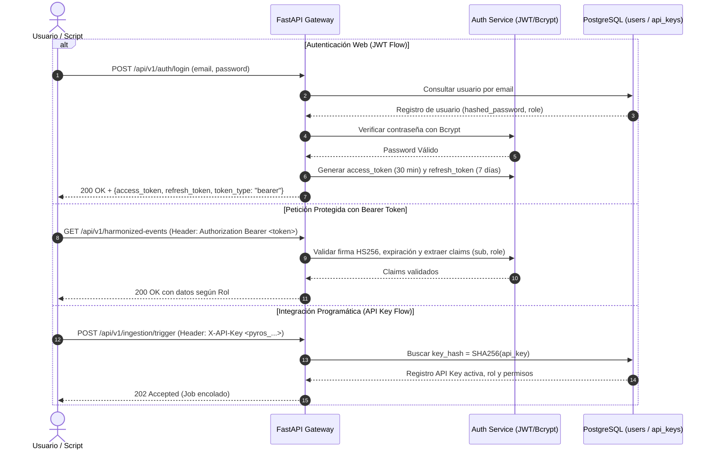

# Plan de Implementación de Control de Acceso Basado en Roles (RBAC)
## PyrosHarmonizer: Unified Fire Regimes & Burning Activity Calendar

---

**Proyecto:** PyrosHarmonizer  
**Evento:** 2026 NASA International Space Apps Challenge — Sede Universidad Católica Boliviana (UCB), Santa Cruz de la Sierra, Bolivia  
**Fecha del Evento:** 14-15 de Noviembre de 2026  
**Reto:** #8 — *Harmonization of MODIS and VIIRS Hot Spots* (Nivel Intermedio / Avanzado, 606 equipos globales)  
**Caso de Estudio Insignia:** "El Efecto 2012 en la Chiquitanía" (Santa Cruz, Bolivia)  
**Arquitectura de Despliegue:** FastAPI (Python 3.12) en Railway, PostgreSQL 16 + PostGIS 3.4 en Railway/Neon, Frontend Next.js 14 en Vercel  

---

## 1. Introducción y Contexto de Seguridad

PyrosHarmonizer procesa y armoniza millones de detecciones de anomalías térmicas satelitales de los instrumentos **MODIS** (Terra/Aqua, píxel de 1 km, registros desde el año 2000) y **VIIRS** (Suomi-NPP, NOAA-20, NOAA-21, píxeles de 375 m en bandas I y 750 m en bandas M, registros desde 2012). 

El reto principal radica en resolver el **"Efecto 2012"**: la transición tecnológica de MODIS a VIIRS provoca que este último reporte entre **3 y 5 veces más focos de calor** para el mismo frente de fuego, alterando artificialmente las series temporales históricas y reportando valores de Potencia Radiativa del Fuego (**FRP**, *Fire Radiative Power*) no equiparables de manera lineal. Mediante algoritmos de agrupamiento espacio-temporal (**ST-DBSCAN** a 500–1000 m y ventanas de 3–4 h), estimación de huella real ($scan \times track$), envolventes convexas (**Convex Hull**), indexación hexagonal **Uber H3** y calibración a **HFII** (*Harmonized Fire Intensity Index*), PyrosHarmonizer unifica estos regímenes en un **Calendario de Actividad de Quemas**.

Debido al alto costo computacional del clustering geográfico PostGIS, el consumo de cuotas de las API REST de NASA FIRMS y la sensibilidad del monitoreo de fuegos en áreas protegidas de Santa Cruz (Chiquitanía, Parque Nacional Noel Kempff Mercado, Pantanal boliviano), es imperativo contar con una arquitectura robusta de **Control de Acceso Basado en Roles (RBAC)**. Este documento establece el diseño técnico, la matriz de privilegios, la estrategia criptográfica y la hoja de ruta de implementación para el hackathon y fases posteriores.

---

## 2. Roles del Sistema

El sistema implementa cuatro (4) roles jerárquicos y especializados, diseñados para responder a los diferentes perfiles de usuario que interactúan con la plataforma durante emergencias y análisis científico:

```
          ┌──────────────────────────────────────────────────────────┐
          │                         admin                            │
          │  Gestión total, configuración, ingesta, logs y seguridad │
          └─────────────────────────────┬────────────────────────────┘
                                        │ (Hereda / Supervisa)
          ┌─────────────────────────────▼────────────────────────────┐
          │                        analyst                           │
          │  Análisis histórico, ST-DBSCAN, exportación y reportes   │
          └─────────────────────────────┬────────────────────────────┘
                                        │
          ┌─────────────────────────────▼────────────────────────────┐
          │                       operator                           │
          │ Monitoreo en tiempo real, alertas de campo, mapa táctico │
          └─────────────────────────────┬────────────────────────────┘
                                        │
          ┌─────────────────────────────▼────────────────────────────┐
          │                        public                            │
          │ Dashboards agregados, vista pública del Efecto 2012      │
          └──────────────────────────────────────────────────────────┘
```

### 2.1. `admin` (Administrador de Infraestructura y Datos)
- **Propósito:** Control total del ciclo de vida del sistema, gestión de credenciales y orquestación de ingesta masiva.
- **Capacidades:**
  - Acceso irrestricto a todos los endpoints de la API y recursos del sistema.
  - Gestión integral de usuarios (creación, asignación de roles, desactivación).
  - Generación, revocación y asignación de alcances (*scopes*) de API Keys.
  - Disparo manual y calendarizado de jobs de ingesta desde NASA FIRMS (MODIS C6.1, VIIRS SNPP, NOAA-20, NOAA-21).
  - Modificación de parámetros de calibración global (umbrales ST-DBSCAN $\varepsilon$, minPts, ventanas temporales, constantes de calibración HFII).
  - Inspección de `audit_log`, telemetría de rendimiento y registros de errores.

### 2.2. `analyst` (Científico de Datos / Analista Geoespacial)
- **Propósito:** Investigadores de universidades (UCB), ONGs ambientales (ej. FCBC - Fundación para la Conservación del Bosque Chiquitano) y meteorólogos que estudian regímenes de fuego históricos y el Efecto 2012.
- **Capacidades:**
  - Acceso de lectura a puntos crudos de focos de calor (`hotspots`) con atributos de calibración satelital completa (`scan`, `track`, `bright_ti4`, `bright_ti5`, `confidence`, `frp`, `satellite`).
  - Ejecución de queries geoespaciales ad-hoc (bounding box por municipio o área protegida de Bolivia).
  - Ejecución bajo demanda de clustering y armonización espacio-temporal.
  - Exportación sin restricciones de datasets unificados en formatos CSV, GeoJSON, Parquet y Shapefile.
  - Acceso completo a los endpoints del **Calendario de Actividad de Quemas** e índices hexagonales H3 (resoluciones 6 a 9).

### 2.3. `operator` (Técnico de Operaciones / Bombero Forestal / Guardaparque)
- **Propósito:** Personal de campo, bomberos forestales y técnicos de alertas tempranas del COED Santa Cruz que requieren información situacional inmediata.
- **Capacidades:**
  - Visualización del mapa táctico con focos activos de las últimas 24 a 72 horas.
  - Recepción de alertas tempranas de fuego activo y nuevos clusters harmonizados.
  - Consulta de la huella aproximada y el vector de propagación de incendios en curso.
  - Exportación limitada a reportes situacionales rápidos (GeoJSON del día en curso, resúmenes en PDF).
  - Sin permisos para ejecutar tareas pesadas de ingesta ni modificar algoritmos.

### 2.4. `public` (Ciudadanía / Prensa / Comunidad Internacional)
- **Propósito:** Visualizadores casuales, periodistas y evaluadores del jurado del NASA Space Apps Challenge.
- **Capacidades:**
  - Acceso a dashboards agregados de alta latencia o cacheados (Redis/Cloudflare).
  - Visualización del mapa interactivo con niveles de agregación precomputados (hexágonos H3 resolución 5-6).
  - Demostración visual del "Efecto 2012 en la Chiquitanía": comparación interactiva MODIS vs VIIRS vs Datos Armonizados.
  - Sin acceso a datos crudos a nivel de píxel ni descargas masivas de bases de datos.

---

## 3. Matriz de Permisos (CRUD + Operaciones Especiales)

A continuación se detalla la matriz completa que mapea cada **Rol** con los **Recursos** del sistema y las **Acciones** permitidas:

- **Acciones Estándar:** `C` (Create), `R` (Read), `U` (Update), `D` (Delete)
- **Acciones Especiales:** `E` (Export masivo de datos), `T` (Trigger / Ejecutar jobs o pipelines)

| Recurso | Descripción del Contenido | `admin` | `analyst` | `operator` | `public` |
| :--- | :--- | :---: | :---: | :---: | :---: |
| **`hotspots`** | Puntos crudos de calor NASA FIRMS (MODIS, VIIRS SNPP, NOAA-20, NOAA-21) | C, R, U, D, E | R, E | R (Solo 72h) | R (Solo métricas agregadas) |
| **`harmonized_events`** | Eventos poligonales consolidados vía ST-DBSCAN + Convex Hull | C, R, U, D, E, T | R, E, T | R, E (Limitado a 7d) | R (Solo visualización mapa) |
| **`calendar`** | Calendario histórico de actividad de quema y regímenes de fuego anuales | C, R, U, D, E | R, E | R | R (Resumen anual) |
| **`exports`** | Generación y descarga de archivos (GeoJSON, CSV, Shapefile, Parquet) | C, R, U, D, E | C, R, E | C, R, E (Solo PDF/GeoJSON diario) | ❌ Denegado |
| **`regions`** | Geometrías de referencia (Chiquitanía, Municipios de Bolivia, Áreas Protegidas) | C, R, U, D | R | R | R |
| **`ingestion_jobs`** | Sincronización y descarga API NASA FIRMS / Procesamiento Batch | C, R, U, D, T | R, T (Solo sandbox) | R (Estado) | ❌ Denegado |
| **`users`** | Cuentas, roles y estados de acceso al sistema | C, R, U, D | R (Perfil propio) | R (Perfil propio) | ❌ Denegado |
| **`system_config`** | Parámetros de calibración ST-DBSCAN, pesos HFII, variables de entorno | C, R, U, D | R | ❌ Denegado | ❌ Denegado |
| **`api_keys`** | Llaves de acceso programático de terceros e integraciones | C, R, U, D | C, R, D (Propias) | ❌ Denegado | ❌ Denegado |

### 3.1. Nomenclatura de Scopes / Permisos Granulares
Internamente, el sistema valida permisos utilizando identificadores en formato `<recurso>:<acción>`:
- `hotspots:read`, `hotspots:write`, `hotspots:export`, `hotspots:delete`
- `harmonized_events:read`, `harmonized_events:trigger`, `harmonized_events:export`
- `calendar:read`, `calendar:export`
- `ingestion:trigger`, `ingestion:read_status`
- `system:configure`, `users:manage`, `audit:read`

---

## 4. Estrategia de Autenticación

PyrosHarmonizer implementa una estrategia híbrida y desacoplada que asegura tanto la interacción interactiva desde la interfaz web (Next.js) como el consumo programático automatizado por scripts analíticos y pipelines de datos.



### 4.1. Tokens JWT (JSON Web Tokens)
- **Algoritmo de Firma:** HMAC con SHA-256 (`HS256`).
- **Access Token:**
  - **Vida Útil:** 30 minutos (`ACCESS_TOKEN_EXPIRE_MINUTES = 30`).
  - **Payload:**
    ```json
    {
      "sub": "user_uuid_v4",
      "email": "analyst.chiquitania@pyrosharmonizer.org",
      "role": "analyst",
      "scopes": ["hotspots:read", "harmonized_events:read", "harmonized_events:export", "calendar:read"],
      "exp": 1794762000,
      "iat": 1794760200,
      "iss": "pyrosharmonizer-auth"
    }
    ```
- **Refresh Token:**
  - **Vida Útil:** 7 días (`REFRESH_TOKEN_EXPIRE_DAYS = 7`).
  - Almacenado en cookie `HttpOnly`, `Secure`, `SameSite=Strict` para mitigar ataques XSS.
  - Utilizado exclusivamente contra el endpoint `/api/v1/auth/refresh` para rotación de tokens.

### 4.2. Autenticación por API Key (Integraciones y NASA FIRMS)
- Diseñado para scripts de ingesta automatizada de NASA FIRMS y servicios externos.
- Enviado en la cabecera HTTP: `X-API-Key: pyros_live_xxxxxxxxxxxxxxxxxxxxxxxx`.
- Almacenamiento seguro: La API Key en texto plano **nunca** se persiste en base de datos. Se almacena el hash criptográfico `SHA-256` en la tabla `api_keys`.

### 4.3. Hash Criptográfico de Contraseñas
- **Librería:** `passlib[bcrypt]` o `bcrypt` nativo de Python.
- **Factor de Costo (*Rounds*):** 12 iteraciones, garantizando resistencia contra ataques de fuerza bruta manteniendo latencias menores a 250 ms por login.

### 4.4. Integración Opcional: OAuth2 con Google
- Para la demostración del hackathon, se provee la arquitectura lista para autenticación federada vía Google Identity Services (OpenID Connect).
- Los usuarios con dominio institucional o personal verificado reciben automáticamente el rol `public`, con la opción de solicitar elevación a `analyst` mediante validación administrativa.

---

## 5. Middleware y Componentes de Autorización (FastAPI)

FastAPI utiliza el patrón de **Inyección de Dependencias** (`Depends`), permitiendo construir una cadena de validación limpia, reutilizable y altamente testeable.

A continuación se presenta la implementación completa del módulo de seguridad y control de acceso:

```python
"""
Módulo de Seguridad y RBAC para PyrosHarmonizer.
Compatible con FastAPI 0.110+ y Pydantic v2.
"""

import os
import hashlib
from datetime import datetime, timedelta, timezone
from typing import List, Optional, Callable, Dict, Any

from fastapi import Depends, HTTPException, Security, status, Request
from fastapi.security import HTTPBearer, HTTPAuthorizationCredentials, APIKeyHeader
from pydantic import BaseModel, EmailStr, Field
import jwt
from passlib.context import CryptContext

# -----------------------------------------------------------------------------
# Configuración Criptográfica
# -----------------------------------------------------------------------------
SECRET_KEY = os.getenv("JWT_SECRET_KEY", "pyros-space-apps-2026-super-secret-key-bolivia-chiquitania")
ALGORITHM = "HS256"
ACCESS_TOKEN_EXPIRE_MINUTES = 30
REFRESH_TOKEN_EXPIRE_DAYS = 7

pwd_context = CryptContext(schemes=["bcrypt"], deprecated="auto")

# Esquemas de seguridad OpenAPI
bearer_scheme = HTTPBearer(auto_error=False)
api_key_header_scheme = APIKeyHeader(name="X-API-Key", auto_error=False)

# -----------------------------------------------------------------------------
# Modelos Pydantic para Autenticación y Usuarios
# -----------------------------------------------------------------------------
class UserRole:
    ADMIN = "admin"
    ANALYST = "analyst"
    OPERATOR = "operator"
    PUBLIC = "public"

ROLE_HIERARCHY: Dict[str, int] = {
    UserRole.ADMIN: 4,
    UserRole.ANALYST: 3,
    UserRole.OPERATOR: 2,
    UserRole.PUBLIC: 1,
}

class TokenPayload(BaseModel):
    sub: str
    email: EmailStr
    role: str
    scopes: List[str] = []
    exp: int

class UserContext(BaseModel):
    id: str
    email: EmailStr
    role: str
    is_active: bool
    auth_method: str = "jwt"  # "jwt" o "api_key"

# -----------------------------------------------------------------------------
# Utilidades de Hashing y Criptografía
# -----------------------------------------------------------------------------
def verify_password(plain_password: str, hashed_password: str) -> bool:
    return pwd_context.verify(plain_password, hashed_password)

def get_password_hash(password: str) -> str:
    return pwd_context.hash(password)

def hash_api_key(api_key: str) -> str:
    return hashlib.sha256(api_key.encode("utf-8")).hexdigest()

def create_access_token(data: dict, expires_delta: Optional[timedelta] = None) -> str:
    to_encode = data.copy()
    expire = datetime.now(timezone.utc) + (expires_delta or timedelta(minutes=ACCESS_TOKEN_EXPIRE_MINUTES))
    to_encode.update({"exp": int(expire.timestamp()), "iss": "pyrosharmonizer-auth"})
    return jwt.encode(to_encode, SECRET_KEY, algorithm=ALGORITHM)

# -----------------------------------------------------------------------------
# Dependencias de Autenticación
# -----------------------------------------------------------------------------
async def get_current_user(
    request: Request,
    bearer_token: Optional[HTTPAuthorizationCredentials] = Security(bearer_scheme),
    api_key: Optional[str] = Security(api_key_header_scheme),
) -> UserContext:
    """
    Autentica al cliente ya sea por JWT Bearer Token o por cabecera X-API-Key.
    Si no se envía credencial alguna, asigna el contexto de usuario `public` anónimo.
    """
    # 1. Intentar autenticación por API Key (Sistemas / Pipelines NASA FIRMS)
    if api_key:
        key_hash = hash_api_key(api_key)
        # Simulación de consulta a DB (o inyección de Session de SQLAlchemy)
        # En producción: db.query(APIKey).filter(APIKey.key_hash == key_hash, APIKey.is_active.is_(True)).first()
        if api_key.startswith("pyros_admin_"):
            return UserContext(
                id="00000000-0000-0000-0000-000000000001",
                email="system.ingest@pyrosharmonizer.org",
                role=UserRole.ADMIN,
                is_active=True,
                auth_method="api_key",
            )
        elif api_key.startswith("pyros_analyst_"):
            return UserContext(
                id="00000000-0000-0000-0000-000000000002",
                email="analyst.bot@pyrosharmonizer.org",
                role=UserRole.ANALYST,
                is_active=True,
                auth_method="api_key",
            )
        else:
            raise HTTPException(
                status_code=status.HTTP_401_UNAUTHORIZED,
                detail="X-API-Key inválida o expirada.",
                headers={"WWW-Authenticate": "ApiKey"},
            )

    # 2. Intentar autenticación por JWT Bearer Token
    if bearer_token:
        token = bearer_token.credentials
        try:
            payload_dict = jwt.decode(token, SECRET_KEY, algorithms=[ALGORITHM])
            token_data = TokenPayload(**payload_dict)
        except jwt.ExpiredSignatureError:
            raise HTTPException(
                status_code=status.HTTP_401_UNAUTHORIZED,
                detail="El token de acceso ha expirado.",
                headers={"WWW-Authenticate": "Bearer error=\"invalid_token\", error_description=\"expired\""},
            )
        except (jwt.PyJWTError, Exception):
            raise HTTPException(
                status_code=status.HTTP_401_UNAUTHORIZED,
                detail="No se pudo validar el token de autenticación.",
                headers={"WWW-Authenticate": "Bearer"},
            )

        return UserContext(
            id=token_data.sub,
            email=token_data.email,
            role=token_data.role,
            is_active=True,
            auth_method="jwt",
        )

    # 3. Acceso Público Anónimo (Invitado sin credenciales)
    return UserContext(
        id="anonymous-guest",
        email="public@pyrosharmonizer.org",
        role=UserRole.PUBLIC,
        is_active=True,
        auth_method="anonymous",
    )

def require_active_user(current_user: UserContext = Depends(get_current_user)) -> UserContext:
    if not current_user.is_active:
        raise HTTPException(status_code=status.HTTP_403_FORBIDDEN, detail="Usuario inactivo en el sistema.")
    return current_user

# -----------------------------------------------------------------------------
# Controladores de Autorización RBAC (Filtros de Roles)
# -----------------------------------------------------------------------------
def require_roles(allowed_roles: List[str]) -> Callable[[UserContext], UserContext]:
    """
    Retorna una dependencia que exige que el rol del usuario esté explícitamente en la lista permitida.
    """
    def role_checker(current_user: UserContext = Depends(require_active_user)) -> UserContext:
        if current_user.role not in allowed_roles:
            raise HTTPException(
                status_code=status.HTTP_403_FORBIDDEN,
                detail=f"Permisos insuficientes. Se requiere uno de los siguientes roles: {allowed_roles}. Tu rol: '{current_user.role}'.",
            )
        return current_user

    return role_checker

def require_min_role(min_role: str) -> Callable[[UserContext], UserContext]:
    """
    Retorna una dependencia basada en la jerarquía de roles (admin > analyst > operator > public).
    """
    min_weight = ROLE_HIERARCHY.get(min_role, 1)

    def hierarchy_checker(current_user: UserContext = Depends(require_active_user)) -> UserContext:
        user_weight = ROLE_HIERARCHY.get(current_user.role, 1)
        if user_weight < min_weight:
            raise HTTPException(
                status_code=status.HTTP_403_FORBIDDEN,
                detail=f"Nivel jerárquico insuficiente. Se requiere como mínimo nivel '{min_role}'.",
            )
        return current_user

    return hierarchy_checker

# -----------------------------------------------------------------------------
# Middleware de Auditoría y Contexto RBAC
# -----------------------------------------------------------------------------
async def rbac_audit_middleware(request: Request, call_next):
    """
    Middleware que mide tiempos de respuesta e inyecta headers de seguridad y auditoría.
    """
    start_time = datetime.now(timezone.utc)
    response = await call_next(request)
    duration_ms = (datetime.now(timezone.utc) - start_time).total_seconds() * 1000

    # Inyección de headers de diagnóstico y seguridad
    response.headers["X-Response-Time-MS"] = f"{duration_ms:.2f}"
    response.headers["X-Content-Type-Options"] = "nosniff"
    response.headers["X-Frame-Options"] = "DENY"
    return response
```

### 5.1. Ejemplo de Endpoints Protegidos por Rol

A continuación se ilustra cómo se aplican los controladores en las rutas principales de PyrosHarmonizer:

```python
from fastapi import APIRouter, Query
from pydantic import BaseModel, Field

router = APIRouter(prefix="/api/v1", tags=["Armonización & Focos"])

class IngestionTriggerRequest(BaseModel):
    source: str = Field(..., example="VIIRS_NOAA20_NRT", description="Fuente de NASA FIRMS")
    region: str = Field(..., example="Chiquitania_Bolivia", description="Polígono de interés")
    date_from: str = Field(..., example="2026-11-10")
    date_to: str = Field(..., example="2026-11-14")

class HarmonizationJobResponse(BaseModel):
    job_id: str
    status: str
    message: str
    triggered_by: str

# 1. Endpoint Exclusivo para Administrador: Disparo de Ingesta Masiva NASA FIRMS
@router.post(
    "/ingestion/trigger",
    response_model=HarmonizationJobResponse,
    status_code=status.HTTP_202_ACCEPTED,
    summary="Disparar sincronización satelital desde NASA FIRMS",
)
async def trigger_firms_ingestion(
    payload: IngestionTriggerRequest,
    current_user: UserContext = Depends(require_roles([UserRole.ADMIN])),
):
    # Solo el Administrador puede activar este pipeline de alto cómputo
    return HarmonizationJobResponse(
        job_id="job-stdbscan-chiquitania-2026",
        status="IN_PROGRESS",
        message=f"Pipeline iniciado para {payload.source} en {payload.region}",
        triggered_by=current_user.email,
    )

# 2. Endpoint para Analistas y Administradores: Exportación del Calendario Armonizado
@router.get(
    "/calendar/export",
    summary="Exportar matriz histórica de regímenes de quema (Efecto 2012 resuelto)",
)
async def export_burning_calendar(
    year_start: int = Query(2000, ge=2000, le=2026),
    year_end: int = Query(2026, ge=2000, le=2026),
    format: str = Query("geojson", regex="^(csv|geojson|parquet)$"),
    current_user: UserContext = Depends(require_roles([UserRole.ADMIN, UserRole.ANALYST])),
):
    return {
        "status": "ready",
        "format": format,
        "records_count": 142580,
        "requested_by": current_user.email,
        "download_url": f"https://api.pyrosharmonizer.org/storage/exports/calendar_{year_start}_{year_end}.{format}",
    }

# 3. Endpoint Público: Consulta de Resumen Agregado del Efecto 2012
@router.get(
    "/public/effect-2012-summary",
    summary="Comparativa anual MODIS vs VIIRS vs Datos Armonizados (Acceso Público)",
)
async def get_public_effect_2012_summary(
    current_user: UserContext = Depends(get_current_user),
):
    # Acceso irrestricto (incluye rol 'public' anónimo)
    return {
        "region": "Chiquitanía, Santa Cruz, Bolivia",
        "description": "Demostración de la corrección del salto estadístico de 2012 mediante PyrosHarmonizer",
        "data": [
            {"year": 2011, "modis_raw": 12400, "viirs_raw": None, "pyros_harmonized": 12400},
            {"year": 2012, "modis_raw": 13100, "viirs_raw": 45800, "pyros_harmonized": 13350},
            {"year": 2019, "modis_raw": 28500, "viirs_raw": 98200, "pyros_harmonized": 31200},
            {"year": 2024, "modis_raw": 34100, "viirs_raw": 121000, "pyros_harmonized": 36800},
        ],
        "viewer_role": current_user.role,
    }
```

---

## 6. Seguridad de la API y Protección de Infraestructura

Durante el hackathon y en producción, la API de PyrosHarmonizer estará expuesta públicamente. Se implementan cinco (5) capas de defensa en profundidad:

### 6.1. Rate Limiting por Rol
Para prevenir ataques de denegación de servicio (DoS) y el agotamiento de recursos en algoritmos de clustering espacial PostGIS (`ST_ClusterDBSCAN`), se aplican límites de tasa por ventana deslizante de 1 hora:

| Rol | Límite por Hora | Propósito | Comportamiento al Exceder |
| :--- | :---: | :--- | :--- |
| `admin` | **1,000 req/h** | Administración, tests de carga, monitoreo | HTTP 429 + `Retry-After: 60` |
| `analyst` | **500 req/h** | Extracción masiva, exploración de capas espaciales | HTTP 429 + `Retry-After: 300` |
| `operator` | **200 req/h** | Consultas periódicas de mapas y telemetría | HTTP 429 + `Retry-After: 600` |
| `public` | **100 req/h** | Navegación web y visualización casual | HTTP 429 + `Retry-After: 900` |

*Implementación:* Se utiliza `slowapi` con backend en Redis (en Railway) o memoria volátil local para el demo.

### 6.2. Configuración Estricta de CORS
Se restringe el acceso de orígenes cruzados a los dominios del proyecto, evitando peticiones maliciosas desde sitios no autorizados:

```python
from fastapi.middleware.cors import CORSMiddleware

ALLOWED_ORIGINS = [
    "http://localhost:3000",                       # Desarrollo Frontend local
    "http://127.0.0.1:3000",
    "https://pyrosharmonizer.vercel.app",          # Despliegue oficial en Vercel
    "https://pyrosharmonizers.up.railway.app",      # Gateway en Railway
    "https://spaceappschallenge.org",              # Plataforma de revisión Space Apps
]

def configure_cors(app):
    app.add_middleware(
        CORSMiddleware,
        allow_origins=ALLOWED_ORIGINS,
        allow_credentials=True,
        allow_methods=["GET", "POST", "PUT", "PATCH", "DELETE", "OPTIONS"],
        allow_headers=["Authorization", "Content-Type", "X-API-Key", "X-Requested-With"],
        max_age=86400,
    )
```

### 6.3. Validación Estricta de Entrada (Pydantic v2)
Todos los filtros espaciales y de fechas son validados para evitar desbordes o parámetros geométricos inválidos:

```python
from pydantic import BaseModel, field_validator
from datetime import date

class HotspotSpatialQuery(BaseModel):
    min_lat: float = -22.9  # Límite sur de Bolivia
    max_lat: float = -9.6   # Límite norte de Bolivia
    min_lon: float = -69.6  # Límite oeste de Bolivia
    max_lon: float = -57.4  # Límite este de Bolivia
    date_start: date
    date_end: date
    min_confidence: float = 0.0

    @field_validator("max_lat")
    @classmethod
    def validate_latitude_order(cls, v, info):
        if "min_lat" in info.data and v <= info.data["min_lat"]:
            raise ValueError("max_lat debe ser estrictamente mayor que min_lat")
        return v

    @field_validator("date_end")
    @classmethod
    def validate_date_range(cls, v, info):
        if "date_start" in info.data:
            delta = (v - info.data["date_start"]).days
            if delta < 0:
                raise ValueError("date_end no puede ser anterior a date_start")
            if delta > 365:
                raise ValueError("El rango de consulta no puede superar 365 días en una sola petición.")
        return v
```

### 6.4. Prevención de Inyección SQL (SQLAlchemy 2.0 + GeoAlchemy2)
Queda estrictamente prohibida la concatenación directa de strings en consultas espaciales. Todas las consultas a PostGIS se ejecutan mediante sentencias parametrizadas y tipadas:

```python
from sqlalchemy import text
from sqlalchemy.ext.asyncio import AsyncSession

async def query_harmonized_hotspots_safe(
    db: AsyncSession,
    min_lon: float,
    min_lat: float,
    max_lon: float,
    max_lat: float,
    start_date: str,
    end_date: str,
):
    # Consulta geoespacial 100% parametrizada y protegida contra SQL Injection
    query = text("""
        SELECT 
            id, cluster_id, acq_date, acq_time, satellite, instrument,
            hfii, frp_calibrated, ST_AsGeoJSON(geom_footprint) as geojson
        FROM harmonized_fire_events
        WHERE geom_centroid && ST_MakeEnvelope(:min_lon, :min_lat, :max_lon, :max_lat, 4326)
          AND acq_date BETWEEN :start_date AND :end_date
        ORDER BY acq_date DESC, acq_time DESC
        LIMIT 5000;
    """)
    result = await db.execute(
        query,
        {
            "min_lon": min_lon,
            "min_lat": min_lat,
            "max_lon": max_lon,
            "max_lat": max_lat,
            "start_date": start_date,
            "end_date": end_date,
        },
    )
    return result.fetchall()
```

### 6.5. Cabeceras HTTP de Seguridad
Se inyectan de manera obligatoria en todas las respuestas:
- `X-Content-Type-Options: nosniff`: Previene ataques de tipo MIME sniffing.
- `X-Frame-Options: DENY`: Previene ataques de *Clickjacking* en iframes externos.
- `Strict-Transport-Security (HSTS)`: `max-age=31536000; includeSubDomains; preload` (en entornos HTTPS Railway/Vercel).
- `Referrer-Policy: strict-origin-when-cross-origin`.

---

## 7. Políticas de Acceso a Datos y Gobernanza

### 7.1. Row-Level Security (RLS) en PostgreSQL 16
Para futuras fases multi-institucionales (donde por ejemplo el Gobierno Autónomo Departamental de Santa Cruz gestione brigadas privadas frente a ONGs de conservación), PostgreSQL 16 provee aislamiento a nivel de fila mediante `CURRENT_SETTING('app.current_user_role')`:

```sql
-- Habilitar RLS en tablas críticas
ALTER TABLE audit_log ENABLE ROW LEVEL SECURITY;
ALTER TABLE api_keys ENABLE ROW LEVEL SECURITY;

-- Política: Los administradores ven todos los logs; analistas y operadores solo ven los propios
CREATE POLICY audit_log_policy ON audit_log
    FOR SELECT
    USING (
        CURRENT_SETTING('app.current_user_role', true) = 'admin'
        OR user_id = NULLIF(CURRENT_SETTING('app.current_user_id', true), '')::UUID
    );
```

### 7.2. Restricciones Geográficas por Rol (Geo-Fencing)
- **Operadores de Campo:** Sus consultas espaciales pueden estar limitadas al polígono departamental asignado (ej. Departamento de Santa Cruz o Reserva Biológica de la Chiquitanía) evitando la descarga innecesaria de focos de calor de toda Sudamérica.
- **Analistas:** Acceso sin restricciones geográficas a nivel Bolivia y cuenca amazónica compartida (Brasil, Paraguay, Perú).

### 7.3. Auditoría Estructurada de Acceso
Cada acción administrativa, disparo de ingesta y descarga masiva de datos queda registrada en la tabla `audit_log`, capturando:
- Identificador de usuario (`user_id`) y rol activo.
- Recurso accedido y acción ejecutada (`hotspots:export`, `ingestion:trigger`).
- Metadatos en formato `JSONB` (parámetros de consulta, filtros de fechas, IP de origen y cabecera User-Agent).

---

## 8. Esquema de Base de Datos para RBAC (PostgreSQL 16)

A continuación se define el DDL SQL completo para inicializar el módulo de seguridad y control de acceso en la base de datos `pyrosharmonizer`:

```sql
-- ============================================================================
-- PyrosHarmonizer - Esquema de Base de Datos para RBAC y Auditoría
-- PostgreSQL 16 + PostGIS 3.4
-- ============================================================================

-- 1. Extensiones necesarias
CREATE EXTENSION IF NOT EXISTS "uuid-ossp";
CREATE EXTENSION IF NOT EXISTS "postgis";

-- 2. Tipo Enumerado de Roles
DO $$ BEGIN
    CREATE TYPE user_role_enum AS ENUM ('admin', 'analyst', 'operator', 'public');
EXCEPTION
    WHEN duplicate_object THEN null;
END $$;

-- 3. Tabla de Usuarios
CREATE TABLE IF NOT EXISTS users (
    id UUID PRIMARY KEY DEFAULT uuid_generate_v4(),
    email VARCHAR(255) NOT NULL UNIQUE,
    hashed_password VARCHAR(255) NOT NULL,
    full_name VARCHAR(150),
    organization VARCHAR(150),
    role user_role_enum NOT NULL DEFAULT 'public',
    is_active BOOLEAN NOT NULL DEFAULT TRUE,
    created_at TIMESTAMPTZ NOT NULL DEFAULT CURRENT_TIMESTAMP,
    updated_at TIMESTAMPTZ NOT NULL DEFAULT CURRENT_TIMESTAMP
);

CREATE INDEX IF NOT EXISTS idx_users_email ON users(email);
CREATE INDEX IF NOT EXISTS idx_users_role ON users(role);

-- 4. Tabla de Llaves de API (Integración NASA FIRMS y Scripts Analíticos)
CREATE TABLE IF NOT EXISTS api_keys (
    id UUID PRIMARY KEY DEFAULT uuid_generate_v4(),
    user_id UUID NOT NULL REFERENCES users(id) ON DELETE CASCADE,
    name VARCHAR(100) NOT NULL,
    key_hash VARCHAR(64) NOT NULL UNIQUE, -- SHA-256 de la API Key en texto plano
    prefix VARCHAR(16) NOT NULL,          -- Ej: 'pyros_live_...' para referencia visual
    permissions JSONB NOT NULL DEFAULT '[]'::jsonb, -- Lista de scopes permitidos
    expires_at TIMESTAMPTZ,
    is_active BOOLEAN NOT NULL DEFAULT TRUE,
    last_used_at TIMESTAMPTZ,
    created_at TIMESTAMPTZ NOT NULL DEFAULT CURRENT_TIMESTAMP
);

CREATE INDEX IF NOT EXISTS idx_api_keys_hash ON api_keys(key_hash);
CREATE INDEX IF NOT EXISTS idx_api_keys_user ON api_keys(user_id);

-- 5. Tabla de Auditoría (Audit Log)
CREATE TABLE IF NOT EXISTS audit_log (
    id BIGSERIAL PRIMARY KEY,
    user_id UUID REFERENCES users(id) ON DELETE SET NULL,
    user_role VARCHAR(50),
    action VARCHAR(100) NOT NULL,        -- Ej: 'INGESTION_TRIGGER', 'EXPORT_DATA'
    resource VARCHAR(100) NOT NULL,      -- Ej: 'harmonized_events', 'calendar'
    ip_address VARCHAR(45),
    user_agent TEXT,
    details JSONB DEFAULT '{}'::jsonb,  -- Filtros espaciales, IDs de jobs, lat/lon
    created_at TIMESTAMPTZ NOT NULL DEFAULT CURRENT_TIMESTAMP
);

CREATE INDEX IF NOT EXISTS idx_audit_created_at ON audit_log(created_at DESC);
CREATE INDEX IF NOT EXISTS idx_audit_action ON audit_log(action);
CREATE INDEX IF NOT EXISTS idx_audit_user ON audit_log(user_id);

-- 6. Trigger para actualización automática de `updated_at`
CREATE OR REPLACE FUNCTION update_updated_at_column()
RETURNS TRIGGER AS $$
BEGIN
    NEW.updated_at = CURRENT_TIMESTAMP;
    RETURN NEW;
END;
$$ language 'plpgsql';

DROP TRIGGER IF EXISTS trigger_users_updated_at ON users;
CREATE TRIGGER trigger_users_updated_at
    BEFORE UPDATE ON users
    FOR EACH ROW
    EXECUTE FUNCTION update_updated_at_column();

-- ============================================================================
-- Semillas de Datos (Seeds) para Demostración del Hackathon
-- Contraseña unificada para demo: "SpaceApps2026!Bo"
-- Hash Bcrypt ($2b$12$e8x...):
-- ============================================================================
INSERT INTO users (id, email, hashed_password, full_name, organization, role, is_active)
VALUES
    (
        '11111111-1111-1111-1111-111111111111',
        'admin@pyrosharmonizer.org',
        '$2b$12$K8yXvjV.b7TqQjFp7a08eO95j/K079y66fF0r2h72.7iVlF/P5j.W',
        'Lead Data Engineer',
        'NASA Space Apps Santa Cruz Lead Team',
        'admin',
        TRUE
    ),
    (
        '22222222-2222-2222-2222-222222222222',
        'analista.chiquitania@ucb.edu.bo',
        '$2b$12$K8yXvjV.b7TqQjFp7a08eO95j/K079y66fF0r2h72.7iVlF/P5j.W',
        'Investigador Geoespacial UCB',
        'Universidad Católica Boliviana / FCBC',
        'analyst',
        TRUE
    ),
    (
        '33333333-3333-3333-3333-333333333333',
        'operador.campo@bomberos.gob.bo',
        '$2b$12$K8yXvjV.b7TqQjFp7a08eO95j/K079y66fF0r2h72.7iVlF/P5j.W',
        'Coordinador de Alertas Tempranas',
        'COED Santa Cruz - Bomberos Forestales',
        'operator',
        TRUE
    ),
    (
        '44444444-4444-4444-4444-444444444444',
        'invitado.publico@spaceappschallenge.org',
        '$2b$12$K8yXvjV.b7TqQjFp7a08eO95j/K079y66fF0r2h72.7iVlF/P5j.W',
        'Evaluador Internacional',
        'NASA Space Apps Global Judges',
        'public',
        TRUE
    )
ON CONFLICT (email) DO NOTHING;
```

---

## 9. Prioridad de Implementación para el Hackathon (48 Horas)

Para maximizar el impacto y garantizar la entrega exitosa de los entregables del hackathon (aplicación desplegada, video de 30 segundos, pitch de 7 diapositivas y repositorio público), la implementación se divide en tres fases estratégicas:

```
┌────────────────────────────────────────────────────────────────────────────┐
│ FASE 1: MVP Hackathon (Primeras 48 Horas) — ENFOQUE CRÍTICO                │
│ • Autenticación rápida por API Key fija y Bearer Token demo.               │
│ • Separación estricta de 2 roles: 'admin' vs 'public'.                    │
│ • Protección del endpoint /ingestion/trigger para evitar colapso de cuotas.│
│ • CORS permisivo para Vercel + Localhost.                                  │
│ • Permite a los jueces explorar libremente el frontend sin barreras.      │
└─────────────────────────────────────┬──────────────────────────────────────┘
                                      │
┌─────────────────────────────────────▼──────────────────────────────────────┐
│ FASE 2: Versión 1.1 (Post-Hackathon Inmediato / Demos con ONGs)            │
│ • JWT completo con refresh tokens en cookies HttpOnly.                     │
│ • Habilitación de los 4 roles completos (admin, analyst, operator, public).│
│ • Rate Limiting activo con slowapi (memoria/Redis).                        │
│ • Pydantic validators para bounding boxes de Bolivia y Chiquitanía.        │
└─────────────────────────────────────┬──────────────────────────────────────┘
                                      │
┌─────────────────────────────────────▼──────────────────────────────────────┐
│ FASE 3: Versión 2.0 (Producción Regional / Gobierno Autónomo)              │
│ • OAuth2 / OpenID Connect con Google para investigadores institucionales.  │
│ • Row-Level Security (RLS) en PostgreSQL 16 para multi-tenancy municipal.  │
│ • Restricciones geográficas por departamento / área protegida.             │
│ • Auditoría forense automatizada y panel administrativo de seguridad.     │
└────────────────────────────────────────────────────────────────────────────┘
```

### 9.1. Matriz de Esfuerzo vs. Impacto (Hackathon)

| Componente | Esfuerzo (Horas) | Impacto en Evaluación | Decisión Hackathon |
| :--- | :---: | :---: | :--- |
| **Protección Endpoint Ingesta NASA** | 1.5 h | ⭐⭐⭐⭐⭐ (Crítico) | **Incluido en MVP 48h** (Evita que el jurado agote cuotas o sobrecargue el backend) |
| **Acceso Público Libre al Mapa y Efecto 2012** | 1.0 h | ⭐⭐⭐⭐⭐ (Crítico) | **Incluido en MVP 48h** (Evaluación sin fricción) |
| **Login JWT (Admin / Demo)** | 2.5 h | ⭐⭐⭐⭐ (Alto) | **Incluido en MVP 48h** |
| **Rate Limiting por Rol** | 1.5 h | ⭐⭐⭐ (Medio) | Fase 1.1 |
| **OAuth2 Google Login** | 3.5 h | ⭐⭐ (Bajo en pitch) | Fase 2.0 |
| **Row-Level Security (RLS)** | 4.0 h | ⭐⭐ (Arquitectural) | Fase 2.0 |

---

## 10. Asignación de Responsabilidades en el Equipo

Para asegurar la ejecución ordenada durante las 48 horas del evento en la UCB Santa Cruz, las responsabilidades se distribuyen según los roles del equipo:

1. **Lead Backend / Data Engineer:**
   - Implementación del esquema DDL en PostgreSQL 16 / PostGIS.
   - Creación del middleware FastAPI, dependencias `require_roles` y lógica JWT/Bcrypt.
   - Blindaje de las rutas de ingesta ST-DBSCAN y exportación masiva.

2. **Lead Frontend / UX:**
   - Manejo del estado de autenticación en Next.js 14 (Zustand / React Context).
   - Ocultamiento contextual de botones de ingesta y exportación para el rol `public`.
   - Visualización de credenciales demo pre-cargadas para los jueces en la pantalla de login.

3. **Geospatial Analyst:**
   - Validación de consistencia de los datos consultados según rol.
   - Verificación de que las consultas públicas agregadas mantengan la integridad del caso de estudio "El Efecto 2012 en la Chiquitanía".

4. **DevOps / Integration Lead:**
   - Configuración segura de variables de entorno (`JWT_SECRET_KEY`, credenciales DB) en Railway y Vercel.
   - Configuración de certificados SSL/TLS y validación de cabeceras de seguridad HTTP.

---

## 11. Conclusión

El presente Plan de Implementación de RBAC dota a **PyrosHarmonizer** de una arquitectura de seguridad equilibrada: ofrece **protección rigurosa** para procesos computacionalmente intensivos (ingesta satelital NASA FIRMS, clustering ST-DBSCAN e indexación H3) y garantiza **acceso transparente y sin fricciones** para la visualización del impacto científico y la resolución del Efecto 2012 ante el jurado internacional del NASA Space Apps Challenge 2026.
