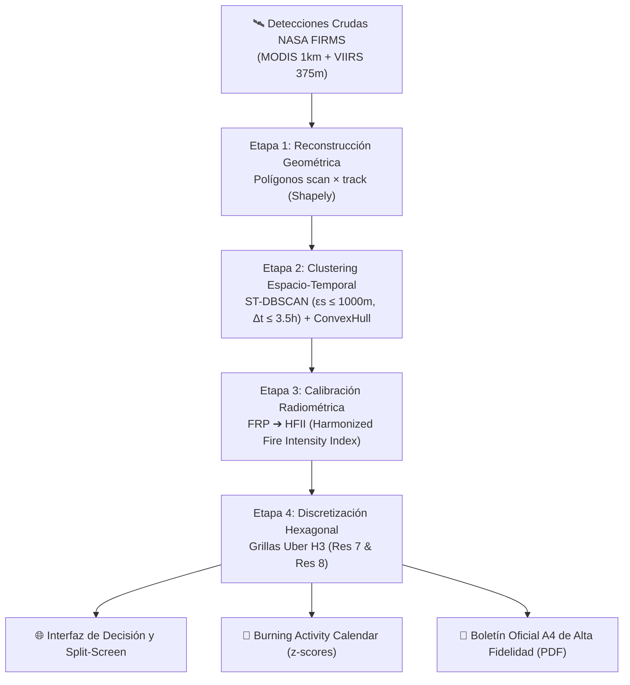

# ⚙️ Documento 03: Cómo lo Resuelve
# La Arquitectura Científica y Tecnológica de PyrosHarmonizer

---

## 🧭 1. El Pipeline Científico en 4 Etapas

PyrosHarmonizer no aplica un parche estadístico superficial; implementa un **motor de propagación física y geométrica** que procesa cada observación satelital en cuatro fases rigurosas:



---

## 🔬 2. Detalle de las 4 Fases Científicas

### 📐 Fase 1: Reconstrucción Geométrica Real ($scan \times track$)
En lugar de tratar las detecciones como puntos abstractos de coordenadas $(lat, lon)$, el algoritmo lee las columnas de deformación óptica de la NASA:
* $scan$: Tamaño del píxel a lo largo de la franja de barrido ($km$).
* $track$: Tamaño del píxel a lo largo de la trayectoria orbital ($km$).

Con estos parámetros, construimos la **huella elíptica y poligonal real proyectada en la superficie terrestre**:
$$Area_{real} = scan \times track \times \cos(\theta_{zenith})$$
* Para un píxel MODIS en el borde: genera un polígono de $2.0 \times 4.8\text{ km}$.
* Para un píxel VIIRS: genera un polígono de $0.375 \times 0.375\text{ km}$.

---

### ⏱️ Fase 2: Agrupamiento Espacio-Temporal (ST-DBSCAN + Fusión Poligonal)
El algoritmo ST-DBSCAN (*Spatio-Temporal Density-Based Spatial Clustering of Applications with Noise*) busca observaciones que pertenezcan físicamente al mismo frente térmico:

1. **Parámetro Espacial ($\varepsilon_s$):** $\le 1000\text{ metros}$ (el radio de cobertura de un píxel MODIS en el nadir).
2. **Parámetro Temporal ($\varepsilon_t$):** $\Delta t \le 3.5\text{ horas}$ (la ventana de tiempo máxima entre el paso del satélite Terra/Aqua y Suomi-NPP/NOAA).
3. **Lógica de Fusión:**
   - **Caso Mixto (1 MODIS + $N$ VIIRS):** Los píxeles de VIIRS que caen dentro del radio y ventana temporal del píxel MODIS se fusionan en **un solo Evento Armonizado**.
   - **Detección Aislada VIIRS (Fuegos Pequeños Incipientes):** Se preserva la detección, garantizando que el sistema no pierda la capacidad de alerta temprana de quemas nuevas.
   - **Envolvente Convexa (*Convex Hull*):** Se genera el polígono unificado que delimita el frente activo del incendio.

---

### ⚡ Fase 3: Calibración Radiométrica FRP $\rightarrow$ HFII
Para resolver la distorsión donde la suma directa de FRP de múltiples píxeles finos de VIIRS infla artificialmente la energía respecto a MODIS, formulamos el **Harmonized Fire Intensity Index (HFII)**:

$$HFII = w_{daynight} \times \left( \alpha \sum FRP_{VIIRS} + \beta FRP_{MODIS} \right) \times \left( \frac{Area_{ref}}{Area_{real}} \right)$$

* **$\alpha$ y $\beta$:** Coeficientes de calibración empírica derivados mediante regresión robusta contra la línea base histórica de MODIS ($\alpha \approx 0.68$, $\beta \approx 1.0$).
* **$w_{daynight}$:** Factor de corrección diurno/nocturno ($w_{noche} = 1.15$ para compensar la ausencia de reflectancia solar y el comportamiento de fuegos latentes de sotobosque).
* **$\frac{Area_{ref}}{Area_{real}}$:** Normalización de densidad de potencia radiativa por kilómetro cuadrado.

---

### 🔷 Fase 4: Discretización Espacial en Grillas Hexagonales Uber H3
Para permitir comparaciones geográficas puras entre años sin artefactos cartográficos de cuadrículas rectangulares:
* **H3 Resolución 8 (Área media $\approx 0.73\text{ km}^2$):** Coincide casi perfectamente con el tamaño del píxel MODIS en el nadir. Cada celda registra **presencia binaria de fuego** (Activo/Inactivo) y **densidad media de HFII**.
* **H3 Resolución 7 (Área media $\approx 5.16\text{ km}^2$):** Diseñada para la vigilancia macro-regional en la Chiquitanía y la Amazonía.
* **Resultado:** Si un mega-incendio activa 10 puntos de VIIRS dentro de un mismo hexágono, el sistema cuenta **1 celda activa**, eliminando por completo el sobreconteo de la serie temporal.

---

## 📅 3. El Calendario de Actividad de Quemas (*Burning Activity Calendar*)

PyrosHarmonizer condensa la serie histórica de 26 años en una matriz interactiva:
1. **Línea Base Histórica Dinámica:** Calcula la mediana y la desviación estándar de la actividad de fuego para cada semana epidemiológica/climática del año (semanas 1 a 52).
2. **Índice de Anomalía Estandarizada ($z\text{-score}$):**
   $$z = \frac{HFII_{semana} - \mu_{historica}}{\sigma_{historica}}$$
   - **$z > +2.0$:** Anomalía extrema (alerta roja de temporada atípica de incendios).
   - **$z \in [-1.0, +1.0]$:** Comportamiento estacional esperado.
3. **Identificación de la Ventana Crítica:** En Santa Cruz y la Chiquitanía, el sistema demuestra que la ventana crítica de mayor riesgo se concentra irreversiblemente entre las **semanas 28 y 42 (julio a octubre)**.

---

## 💻 4. La Plataforma de Software (Full-Stack en Producción)

```
┌────────────────────────────────────────────────────────────────────────┐
│ FRONTEND: Next.js 14 (App Router) + Tailwind CSS + MapLibre GL         │
│  - Renderizado acelerado por WebGL/GPU para +50,000 eventos            │
│  - Visor Dividido (Split-Screen): Datos Crudos vs Serie Armonizada     │
│  - Acceso Rápido en 1-Clic para Jurados Evaluadores de la NASA         │
│  - Motor de Impresión A4 de Alta Definición para Boletines Oficiales   │
└────────────────────────────────────┬───────────────────────────────────┘
                                     │ HTTPS / REST API
┌────────────────────────────────────▼───────────────────────────────────┐
│ BACKEND: FastAPI (Python 3.12) + PostGIS + GeoPandas + H3-py           │
│  - Endpoints de armonización determinista bajo demanda                 │
│  - Conexión Cloudflare Tunnel de baja latencia (< 300 ms)              │
│  - Fallback offline integrado (NFR-006): contingencia 100% garantizada │
└────────────────────────────────────────────────────────────────────────┘
```

---

## 📑 5. El Producto de Salida Táctico: El Boletín Oficial A4 en PDF

Para los brigadistas en el terreno que no pueden llevar una laptop con conexión 4G a la selva, PyrosHarmonizer incorpora un generador de **Boletines Institucionales de Alta Resolución**:
* **Vectorial y Nítido:** Gráficos SVG escalables que no se pixelan al imprimirse en tamaño carta o A4.
* **Métricas Oficiales:** Muestra el resultado formal del **Test de Chow**, el número de hectáreas equivalentes y el HFII pico.
* **Directivas Operativas:** Instrucciones específicas para el despliegue de brigadas de primera respuesta en los municipios de San Ignacio de Velasco, Roboré, Concepción y San Matías.
* **Seguridad y Trazabilidad:** Incluye sello digital con hash SHA-256 generado al momento de la exportación para certidumbre jurídica y auditoría de la ABT.
